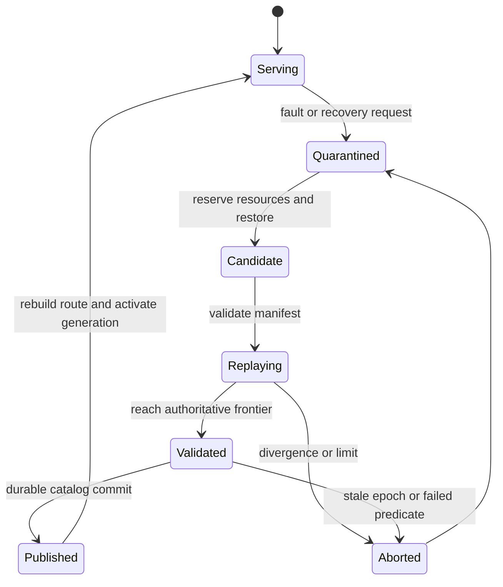

# MnemosyneOS: deeper literature review and implementation decisions

Research date: 8 October 2026. This is a continuation of the architecture plan, with closer reading of papers and selected implementation paths. It distinguishes published results, source observations, and proposed MnemosyneOS mechanisms. None of the external systems was compiled, benchmarked, or formally verified during this review.

The main finding is that the project should revolve around **one recovery contract spanning authority, durable state, and externally visible effects**. A checkpoint restores computation. It does not, by itself, undo an acknowledged write, restore a revoked permission safely, unblock an IPC client, or make an external request safe to repeat.

The accompanying [source-reading guide](C:/Users/ludic/Desktop/mnemosyne/docs/source-reading-guide.md) records pinned repository revisions, concrete files and symbols, license observations, and reuse decisions. The [source manifest](C:/Users/ludic/Desktop/mnemosyne/research/source-manifest.json) records immutable source URLs and SHA-256 digests of downloaded files. Selected files are cached for inspection; this is not a complete dependency or security audit. The broader [architecture plan](C:/Users/ludic/Desktop/mnemosyne/docs/research-plan.md) covers boot, memory, scheduling, capabilities, and the original implementation milestones.

## 1. Decisions changed or strengthened by the research

| Decision | Evidence | Consequence for MnemosyneOS |
| --- | --- | --- |
| Recovery must be a storage and IPC protocol | Rollback-recovery literature, RIFL, Golem's incomplete-call handling | Commit determinants, service data, and completion records together; explicitly handle uncertain external outcomes. |
| Restart must be visible in the IPC ABI | Hubris generations and seL4 endpoint cancellation | Wake blocked callers with a typed peer-restarted result; let the broker implement transparent retry only where safe. |
| Wasmi can suspend on fuel exhaustion | Current `ResumableCallOutOfFuel` implementation | Use resumable calls for execution slices. Do not equate an in-memory continuation with a portable checkpoint. |
| Disabling default features needs care | Wasmi's current Cargo features | Explicitly retain validation, enable fuel, restrict proposals, and configure compilation. |
| redb merits a bounded portability experiment | Current manifest has experimental `no_std` support and a pluggable storage backend | Consider it as a comparison or fallback storage engine; it is not already a filesystem or a proven bare-metal port. |
| Duplicate-result retention is part of correctness | RIFL's completion records and lease validation | Garbage collection needs an acknowledged watermark or an invalidated client epoch. Expiration alone is unsafe. |
| Promotion must survive supervisor failure | Durable execution and crash-consistency work | Store one authoritative publication record; rebuild routing from it after reboot. Fence the old generation. |
| Formal safety and recovery progress are different | Anvil's explicit liveness assumptions | Prove safety for the small policy core first; state scheduling, storage, and fault-quiescence assumptions separately. |
| AI enforcement DSLs already exist | AgentSpec and LLM-Modulo | The contribution must be OS-specific semantics and evidence, not merely generating JSON and checking it. |
| Arbitrary Wasm continuation migration is another project | Weave's compiler transformation; Wizer's narrower purpose | Start with logical checkpoints between handlers. Evaluate transformation only after the baseline works. |

The evidence for repository rows is linked to exact files in the source guide. The paper sections below explain the other rows.

## 2. Papers to read, what they establish, and what transfers

### 2.1 EROS: A Fast Capability System — SOSP 1999

EROS integrates persistent objects, capabilities, and system checkpointing. Its checkpoint mechanism checks structural consistency before committing, and its design constrains where state can reside. It also distinguishes snapshot capture from asynchronous stabilization. Read §3.5 and the object representation discussion. [Paper][eros]

**Transfer:** keep the list of recoverable object types small and define how capabilities are represented persistently. Validate checkpoint structure before publication.

**Boundary:** EROS's whole-system persistence does not establish the semantics of selectively rolling back one MnemosyneOS service while other services continue. Our current-authority rule deliberately makes security state independent of service rollback. Structural checks also cannot establish that application data is semantically correct.

### 2.2 Microreboot: A Technique for Cheap Recovery — OSDI 2004

Microrebooting recovers small components while preserving appropriate state elsewhere. The paper evaluates a componentized Java application and discusses retry and escalation to larger recovery scopes. Read the recovery requirements and experimental methodology, rather than transferring the reported timings to a kernel. [Paper][microreboot]

**Transfer:** make recovery scope explicit: retry a request, replace a worker, restore a service, then reboot only if necessary. Classify state as disposable, reconstructible, or authoritative.

**Boundary:** this relies on component boundaries and state-management assumptions. Restarting a component that owns partially committed cross-component state can preserve the inconsistency. A deterministic software bug may recur after every restart.

### 2.3 CuriOS: Improving Reliability through Operating System Structure — OSDI 2008

CuriOS places client-specific server state outside the server and controls its mapping during requests. This aims to preserve recoverable state while restricting how far a server fault propagates. Read the state organization and recovery sections. [Paper][curios]

**Transfer:** a service should not automatically receive writable access to every client's durable state. A later MnemosyneOS extension could grant one request access to a restricted state partition and revoke that mapping afterward.

**Boundary:** restoring all pages of a service is a much coarser containment policy. CuriOS's historical comparisons and measured recovery rates are tied to its implementations and fault campaign; they are not contemporary rankings of other operating systems.

### 2.4 Theseus: an Experiment in Operating System Structure and State Management — OSDI 2020

Theseus reduces state held across component boundaries and uses Rust's language mechanisms to support component evolution and recovery. Its fault-injection evaluation is especially worth reading carefully: §7.2 reports 800,000 injected faults, approximately 0.083% manifesting, and recovery from 69% of manifested faults. The denominator is essential. [Paper][theseus]

**Transfer:** minimize hidden inter-service state and record masked, manifested, detected, contained, and recovered faults separately.

**Boundary:** this is not evidence that arbitrary malicious native binaries can safely share an address space. Its in-memory state store and crate replacement mechanism also do not supply durable process snapshots or an IPC replay protocol. The source guide separates these mechanisms.

### 2.5 RedLeaf: Isolation and Communication in a Safe Operating System — OSDI 2020

RedLeaf explores language-based domains, controlled ownership transfer, trusted proxies, and clean abort semantics. Shadow domains can mediate driver recovery. Read §3 on domain interfaces and §4.4/§5.4 on shadow drivers and recovery. The recovery microbenchmark uses an in-memory block driver; it is not a general disk crash-consistency experiment. [Paper][redleaf]

**Transfer:** define failure as an explicit cross-domain result and keep restart-specific knowledge in a service facade. A facade must know which operations are safe to retry.

**Boundary:** trusted compilation and constrained cross-domain types are different assumptions from accepting untrusted native binaries. Hardware-isolated processes remain the appropriate baseline for the proposed threat model.

### 2.6 A Survey of Rollback-Recovery Protocols in Message-Passing Systems — ACM Computing Surveys 2002

The survey separates coordinated checkpointing, uncoordinated checkpointing, and pessimistic, optimistic, and causal logging. Its key concepts are nondeterministic-event determinants, orphan processes, and output commitment. Read §2 and §4 before designing the event format. [Survey][rollback]

**Transfer:** choose pessimistic durability at externally visible commit boundaries for the first prototype. A surviving consumer must not depend on an event that recovery cannot reconstruct.

**Boundary:** recording received messages alone is insufficient when clocks, randomness, timeouts, shared memory, or host-call failures affect execution. More efficient causal schemes require substantially more dependency bookkeeping. They are a later optimization, not a small change to a log writer.

### 2.7 Remus: High Availability via Asynchronous Virtual Machine Replication — NSDI 2008

Remus combines VM checkpoint replication with controlled release of external output. Its useful lesson is the relationship between recoverable state and observations made outside the recovery boundary. [Paper][remus]

**Transfer:** do not release a successful response until the data and information needed to recover that response are durable. Benchmark the latency this adds.

**Boundary:** VM replication is not deterministic service replay or repair of a persistent software defect. Network buffering does not provide a general rollback facility for a remote API that has already acted. MnemosyneOS must specify its own effect boundary and endpoint cooperation assumptions.

### 2.8 Engineering Record And Replay For Deployability — 2017 technical paper

The rr paper explains practical replay through controlled scheduling, syscall interception, and hardware execution counters. It is particularly useful for understanding why reproducing arbitrary native execution is harder than logging application messages. The paper explicitly excludes tracees deliberately trying to defeat recording. [Paper][rrpaper]

**Transfer:** restrict the execution environment first, then enumerate every source of nondeterminism. Treat a replay trace as tied to an execution profile.

**Boundary:** rr's Linux mechanisms cannot simply be linked into a microkernel. Its current source has evolved beyond the paper's platform discussion, so use the pinned implementation for current counter and architecture details. Neither the paper nor a successful rr run proves adversarial replay completeness for our design.

### 2.9 Implementing Linearizability at Large Scale and Low Latency — SOSP 2015, RIFL

RIFL attaches unique request identities and durable completion records to retryable operations. Completion records must be atomic with their effects and follow the affected data. Its acknowledgment and lease machinery explains when old records can safely be reclaimed. Read §3–4. [Paper][rifl]

**Transfer:** atomically record the mutation and its result; return the result on duplicate requests. Keep client identity and sequence allocation outside service rollback.

**Boundary:** discarding a completion record after a timer expires is insufficient. A delayed retry must be rejected once its identity is no longer valid. This is a conditional guarantee within a cooperating protocol, not an unconditional claim of exactly-once behavior for arbitrary external systems.

### 2.10 Using Crash Hoare Logic for Certifying the FSCQ File System — SOSP 2015

FSCQ makes crash behavior and recovery procedures part of the specification. Its proof effort and trusted execution boundary are as informative as its filesystem design. Read the logic, logging, assumptions, and implementation sections. [Paper][fscq]

**Transfer:** specify both ordinary postconditions and permitted post-crash states. Start by proving one small commit/recovery primitive rather than the entire filesystem.

**Boundary:** the paper describes roughly 31,000 lines of code and proofs and substantial research effort. Its current repository labels itself an unmaintained research prototype, and `master` corresponds roughly to later DFSCQ work. A theorem about the verified core does not verify the Haskell/FUSE integration or an independently rewritten Rust implementation.

### 2.11 Finding Crash-Consistency Bugs with Bounded Black-Box Crash Testing — OSDI 2018

CrashMonkey and ACE explore small filesystem workloads and crashes around persistence operations. The study reproduced 24 of 26 historical bugs and found ten new ones in its evaluated systems. Read workload generation, persistence-point selection, and the recovery oracle. [Paper][crashmonkey]

**Transfer:** enumerate short ChronicleFS operation sequences, inject crashes at individual writes and flushes, recover, and compare against a set of legal abstract states.

**Boundary:** a process kill is not a model of torn or reordered storage writes. Bounded testing finds bugs within the explored space; it does not prove their absence. The Linux-oriented artifact is a methodology reference, not a ready-made guest block driver.

### 2.12 PoWER Never Corrupts: Tool-Agnostic Verification of Crash Consistency and Corruption Detection — OSDI 2025

PoWER constrains persistent writes using permissions that describe allowed recovery outcomes. Its Rust/Verus and Dafny examples show how crash consistency and corruption detection can be integrated with ordinary verification tools. Read the write interface and distinction between reusable and single-use permissions. [Paper][power]

**Transfer:** model a storage write as permitting every persistence outcome allowed by the hardware abstraction, not just its final in-memory result. A small root-publication primitive is a promising proof target.

**Boundary:** persistent-memory models must be adapted to the actual block-device model. The open repository contains trusted interfaces, verified code, and unverified mocks. The paper artifact has its own branch; current main is not interchangeable with that artifact.

### 2.13 Anvil: Verifying Liveness of Cluster Management Controllers — OSDI 2024

Anvil verifies eventual stable reconciliation of Rust controllers. §4.3.3 spells out fairness, eventual cessation of faults, and interference assumptions. This makes it unusually relevant to the phrase “verified recovery.” [Paper][anvil]

**Transfer:** distinguish invariant preservation from eventual restoration of service. A safe recovery controller can remain quarantined forever if it cannot acquire resources or if every attempt fails.

**Boundary:** Anvil's Kubernetes models and external API assumptions do not prove a microkernel supervisor correct. For MnemosyneOS, reserved recovery resources, bounded retries, and a terminal quarantined outcome are implementable first steps. A liveness theorem needs a model of scheduling and successful storage progress.

### 2.14 Robust Planning with Compound LLM Architectures: An LLM-Modulo Approach — 2024

LLM-Modulo separates proposal generation from independent critics and verification. It provides a useful framework for discussing where planning guarantees come from. [Paper][llmmodulo]

**Transfer:** let the model choose among constrained recovery actions while a deterministic checker determines whether the proposal is admissible under a formal system model.

**Boundary:** a sound checker is only sound for the properties and environment it models. A missing effect, stale authority observation, or unmodeled executor behavior can invalidate the system argument. Model confidence and repeated agreement are not substitutes for these checks.

### 2.15 AgentSpec: Customizable Runtime Enforcement for Safe and Reliable LLM Agents — ICSE 2026

AgentSpec provides trigger, predicate, and enforcement rules for agent behavior. The paper and source include enforcement through stopping, user inspection, and LLM self-reflection. The arXiv v3 record identifies the ICSE 2026 publication. [Paper][agentspec]

**Transfer:** use it as related work for a typed recovery language and interception points.

**Boundary:** a DSL can contain nondeterministic or heuristic enforcement. MnemosyneOS's acceptance decision must depend only on bounded parsing, trusted state, arithmetic, and explicit predicates. Do not describe every DSL-based guard as a formal verifier, or use an LLM-based predicate inside the trusted acceptance path.

### 2.16 Crab: A Semantics-Aware Checkpoint/Restore Runtime for Agent Sandboxes — April 2026 preprint

Crab examines the mismatch between agent-level state and OS effects, using turn context and OS observations to select checkpoint work. Its evaluation replays recorded agent interactions and filters for tasks solvable in a failure-free run. [Preprint][crab]

**Transfer:** useful related work for agent workloads and for separating model variability from recovery experiments.

**Boundary:** this review has not reproduced its results or inspected an implementation artifact. Its container/OS checkpoint setting differs from a custom capability kernel. It nevertheless means “checkpointing AI agents” alone is an inadequate novelty claim.

## 3. The research contribution that remains defensible

The literature already contains capabilities, component restart, persistent operating systems, deterministic replay, verified storage, durable Wasm execution, and agent enforcement languages. MnemosyneOS should test their interaction at a precisely defined boundary.

Proposed contribution:

> A service recovery protocol for a capability microkernel in which historical execution is reconstructed in isolation, current authority is enforced at publication, and acknowledged effects remain consistent across worker and supervisor failures. An untrusted planner selects only among bounded, policy-checked recovery transitions.

This is a research direction, not a verified novelty or priority claim. It is stronger than “Rust OS with AI recovery” because it names properties that can be falsified.

Separate four claims:

1. **Isolation:** a worker cannot access memory, endpoints, or device resources outside its authority.
2. **Replay:** for the declared profile, replay reconstructs the same canonical service state and service-visible trace through a selected committed frontier.
3. **Recovery safety:** replacing the worker preserves acknowledged operations, rejects stale authority, and does not publish two active generations.
4. **Planner utility:** the AI selects useful admissible plans more often, faster, or with less collateral disruption than specified deterministic baselines.

The first three are prerequisites for evaluating the fourth. A negative result for planner utility is still publishable project evidence; it must not be hidden by weakening the baseline.

## 4. Architecture choices after inspecting the implementations

### 4.1 Keep hardware isolation and borrow lifecycle contracts

Use a custom Rust kernel with separate address spaces, one CPU initially, kernel-owned capability tables, and userspace recovery policy. Study seL4 for capability and endpoint lifecycle, Microkit for declared protection domains and resource budgets, and Hubris for failure notification and restarted-peer handling. Study Theseus and RedLeaf for state ownership and restart facades.

A process handle should identify both the logical object and its incarnation. A failed send must distinguish an invalid capability, a revoked right, a dead endpoint, a restarted peer, and an uncertain application outcome. These distinctions belong in the ABI; they cannot be recovered reliably from generic timeout strings.

Do not transplant Hubris's compact generation representation unchanged into an adversarial capability model. Its selected source packs generations into a small task identifier. MnemosyneOS should use sufficiently wide checked generations and refuse reuse on exhaustion. Slot generation, object incarnation, and rights revocation are separate concepts.

### 4.2 Choose handler-boundary Wasm checkpoints first

Recommended initial contract:

- One Wasm instance per worker process and one active handler per instance.
- Validated integer-only modules; fixed memory limits; no shared linear memory, threads, or unmediated I/O.
- Host imports for request input, deterministic broker calls, and bounded output construction.
- Explicit state export/import between handlers, plus a manifest covering all supported mutable state.
- Fuel limits for Wasm execution and separate limits/deadlines for host operations.
- A checkpoint is accepted only at a declared quiescent boundary with no unresolved host call.

Wasmi's current API has fuel-resumable calls and an explicit floating-point validation switch. That makes it a good first candidate. Keep validation enabled when disabling default features. Prefer eager translation for the first reproducible experiment, and record the engine revision, feature set, compilation mode, and fuel-cost configuration.

Resumable fuel execution is useful for scheduling and cancellation. It does not make the private interpreter stack serializable. A volatile COW snapshot of the entire worker can preserve such state within a compatible running system, but durable portable recovery should use the explicit service ABI.

If arbitrary suspension becomes necessary, compare two separate extensions: an engine-specific continuation format or module transformation that materializes continuations. Weave is a concrete example of the latter. Either adds a compatibility and validation problem that the baseline avoids.

### 4.3 Choose the storage contribution explicitly

| Route | What the team implements | Benefit | Remaining burden |
| --- | --- | --- | --- |
| Custom minimal ChronicleFS | COW metadata, commit records, directories/files, snapshots, allocator recovery | Clear OS and storage contribution | Largest correctness risk; needs a storage model and crash campaign. |
| redb-backed service namespace | A backend adapter and filesystem-like namespace above a transactional KV store | Potentially faster path to durable transactions and savepoints | Experimental `no_std` portability; namespace semantics; branch design; device assumptions. |
| Host storage shim for early experiments | Same logical broker API over an ordinary host store | Fast validation of replay and policy semantics | Not a guest filesystem result; cannot substantiate kernel/storage performance. |

Recommendation: use the host shim for protocol experiments immediately, then build a small custom ChronicleFS if the course requires filesystem implementation. Keep a redb experiment as a comparison and schedule fallback. Do not silently substitute a database for the promised filesystem contribution.

For custom ChronicleFS, begin with one writer, immutable committed trees, fixed-size blocks, two or more root-record locations, checksums, and conservative reclamation. Root records need their own atomicity/torn-write contract. Double buffering and CRCs do not create unconditional atomicity, authentication, or semantic validity.

## 5. A concrete recovery protocol to specify before kernel integration

Everything in this section is a proposed MnemosyneOS design, not a claim that the cited systems implement this combination or that its correctness has been established.

### 5.1 Keep independent identities independent

| Identity | Purpose | May service rollback decrease it? |
| --- | --- | --- |
| `service_id` | Stable logical service identity | No |
| `worker_generation` | Fences replaced execution instances | No |
| `object_generation` / `cap_slot_generation` | Rejects stale object references and reused slots | No |
| `policy_epoch` | Invalidates assumptions after authority changes | No |
| `client_epoch` | Names a retry session; invalidates retired request identities | No |
| `request_sequence` | Identifies one operation within a client epoch | No reuse within an epoch |
| `event_sequence` | Identifies recorded service-visible events | Candidate cursor may rewind; durable history cannot be overwritten |
| `commit_sequence` | Orders authoritative durable publications | No |

Use checked increments and explicit exhaustion behavior. Restoring the bytes of an old capability table or request counter is not an acceptable way to reconstruct these identities.

### 5.2 Define the effect boundary

Initially, support requests whose durable mutations fit within one service namespace transaction controlled by the broker and ChronicleFS. The broker owns request identities and output release. Workers propose mutations; they do not directly publish durable effects.

Classify host calls:

| Call class | Live execution | Replay | Outcome after interrupted execution |
| --- | --- | --- | --- |
| Pure computation | Compute locally | Compute locally | Restart from a supported checkpoint |
| Nondeterministic input | Record the exact result/error | Return recorded result/error | Uncommitted invocation can be abandoned if no effect escaped |
| Transactional internal write | Commit data, completion, and replay metadata together | Apply only to a candidate branch and compare | Recover old or new complete transaction |
| External idempotent operation | Use a stable operation key understood by the endpoint | Suppress already accounted effects | Retry/query using the same key under current authority |
| External non-idempotent operation | Excluded from automatic retry in the baseline | Never silently repeat | Mark outcome uncertain and require application-specific reconciliation |

An operation is not idempotent merely because the planner labels it so. The trusted connector contract determines the class. A `BEGIN` record followed by a crash before `END` does not tell us whether an external system acted.

### 5.3 Normal request commit

1. Authenticate the caller and look up `(client_id, client_epoch, request_sequence)` in the broker's authoritative metadata. Bind the identity to an operation digest and reject reuse with different content.
2. Reject an invalid epoch or a sequence older than the retained acknowledgment floor. Return the recorded result for a completed request. Attach a retry to an already running request instead of starting a second copy.
3. Record the input and any service-visible nondeterministic results under a deterministic ordering rule. Reserve enough space for the transaction and its replay metadata before admission.
4. Execute the handler against tentative state and a private storage transaction. Construct a tentative response.
5. Atomically publish the namespace root, completion record, and references to the durable determinants required to reconstruct the resulting service state. The recovery catalog must pin those determinants and a compatible checkpoint.
6. Release the response only after the durability barrier succeeds. If the client receives no response, it retries with the same identity.

For the first implementation, use one serial request stream per service. This simplifies the meaning of the durable frontier and the state that a completed handler includes. It does not eliminate nondeterminism in imported values or error paths.

If a handler traps before commit, discard its tentative storage transaction and restore/reconstruct its application state before accepting another handler. Merely aborting the filesystem transaction does not undo mutations already made to the worker's linear memory.

### 5.4 Safe completion-record reclamation

A fixed retention timer is not a correctness rule. Use one of two explicit mechanisms:

- The client acknowledges a contiguous completion prefix. Persist an acknowledgment floor, retain any required application audit history separately, and reject retries below that floor. State the client contract: an acknowledged result is no longer retrievable through the retry protocol.
- Retire the client epoch in authoritative metadata before reclaiming its records. Requests from that epoch remain invalid, even if an old client image is restored.

A bounded system can initially avoid sophisticated leases: cap active sessions and retained records, require explicit acknowledgment/retirement, and apply backpressure when full. This is easier to reason about than adding distributed clocks. A client that loses both its result and its permitted retry identity must receive an explicit expired/uncertain outcome, not an automatic re-execution.

### 5.5 Restore, replay, and publish



At quarantine, stop new admission and resolve or record in-flight requests. Fence the old worker at every effect-producing interface. A route switch alone is insufficient if an old worker still holds usable storage authority.

Restore a candidate from a compatible checkpoint. Reconstruct historical inputs in isolation, suppress live external output, and replay through the authoritative committed frontier. Verify expected host-call arguments and results, canonical application state, and namespace state. A digest match is a comparison mechanism under stated collision assumptions; it is not proof that the application behaved correctly.

Promotion uses one durable catalog record binding:

```text
service_id, new_worker_generation, module_hash, execution_profile_hash,
checkpoint_id, candidate_state_reference, namespace_root,
replayed_through, acknowledged_commit_frontier,
expected_policy_epoch, previous_catalog_commit, plan_hash
```

In the baseline, serialize publication and authority changes through a trusted commit coordinator. Recheck current authority and reservations at the publication linearization point. Do not leave a check/use gap between checking the policy epoch and committing the record.

After the catalog commit, activate routing for its recorded generation. A supervisor reboot reconstructs routing from the catalog instead of trusting a stale in-memory route. Before the commit, the candidate is discardable. After it, recovery finishes activation of the recorded generation. All writes from other generations remain fenced.

Policy revocation has its own authoritative persistence and acknowledgment rules if it must survive a machine reboot. Keep it outside the service's snapshot branch. A memory-only epoch does not establish durable revocation.

### 5.6 Replay does not restore historical permission

Historical inputs may include data that the service can no longer read under current policy. Storing these inputs creates a security-sensitive log. The replay supervisor must have explicit authority to read that history, protect it from unrelated services, and constrain where recovered data can be published.

Use two different questions:

1. Is this historical computation reproducible inside the candidate's isolated replay environment?
2. Is its proposed publication permitted now?

If the second answer is no, keep the service quarantined or start it under a different explicitly authorized state contract. Do not resurrect a revoked capability merely to make replay succeed. A complete design also needs retention rules for secrets in old checkpoints and logs.

## 6. Counterexamples the design and tests must eliminate

These are reasoning examples, not results from an executed model checker.

| Tempting implementation | Failure trace | Required protection |
| --- | --- | --- |
| Keep deduplication only in worker RAM | Commit increment; lose reply; worker crashes; retry increments again | Completion record commits with the mutation and survives worker loss. |
| Delete retry records after ten minutes | Old packet arrives after deletion and repeats an operation | Durable acknowledgment floor or invalidated client epoch. |
| Restore the client request counter with its checkpoint | Restored client reuses an ID for a different operation | Counter outside rollback; bind request digest; reject same ID with different content. |
| Restore checkpointed capability entries | Snapshot predates a revocation; old access becomes usable | Rebind through current authority and monotonic generations. |
| Check a plan once | Revoke access after validation but before promotion | Recheck and serialize at the sensitive operation's linearization point. |
| Change route, then storage root | Supervisor fails between changes | One authoritative durable publication record with restart rules. |
| Fence only incoming IPC | Old worker issues a direct write after replacement | Generation check at every effect interface; remove bypass capabilities. |
| Abort only storage after a handler traps | Tentative linear-memory changes survive into the next request | Restore worker state as part of request abort. |
| Consider valid CRC equivalent to healthy state | A logic bug writes consistent but incorrect data before snapshot | Application invariants, older checkpoints, and explicit limitations on repair. |
| Retry until success | Repeatable bug consumes all recovery CPU and disk | Budgets, retry limits, reserved supervisor resources, terminal quarantine. |
| Reclaim blocks from the live root alone | Older checkpoint still references a reused block | Trace all pinned roots, manifests, candidates, and replay dependencies. |
| Log a native process's syscalls only | Unmediated shared memory or nondeterministic instructions alter execution | Restricted supported profile or a much larger native replay mechanism. |

One further rule: an AI plan cannot delete or skip an acknowledged operation simply because that operation causes replay to fail. Doing so changes the service's externally committed history. Repairing such history requires a separately specified reconciliation operation with its own authority and audit record.

## 7. What to verify mathematically and what to measure

### 7.1 A small formal core

Keep the first formal model small enough to finish: two clients, two worker generations, a few capability objects, a short log, and a bounded plan. Explore interleavings of request commit, lost response, restart, revoke, record reclamation, and promotion. Then generalize selected invariants in Verus or another suitable prover.

Target invariants:

- **Authority:** every effect or publication is authorized by current policy, even after rollback.
- **No request identity reuse:** equal request identities have equal operation digests; completed operations are not committed twice.
- **Acknowledged-state preservation:** every released successful response has an associated recoverable committed operation.
- **Single active generation:** at most one generation may produce new effects for a service.
- **Candidate confinement:** candidate execution cannot mutate authoritative state before authorized publication.
- **Retention closure:** everything required by a retained recovery point remains allocated and readable by its authorized supervisor.
- **Crash closure:** recovering from every modeled persistence cut yields a legal old or new publication, never a mixed one.

The proof needs assumptions about the storage primitive, kernel enforcement, parser implementation, and executor refinement. A bounded exhaustive search should be described with its bounds; passing it is not an unbounded proof. A theorem about an abstract AST does not automatically cover JSON parsing, integer overflow, or unsafe Rust.

### 7.2 Boundedness needs more than loop-free syntax

A plan with six instructions can still request a terabyte of copying or call a hung driver. Derive cost bounds from authenticated resource sizes; reserve memory and log space before execution; enforce fuel and byte/event limits; and use interruptible host calls with deadlines. Bounds on interpreter instructions are not wall-clock guarantees for storage or device access.

For the baseline DSL, allow only `Quarantine`, `RestoreCandidate`, `ReplayCandidate`, `CheckHealth`, `PromoteCandidate`, and `AbortCandidate`. Health predicates come from a trusted catalog. The AI cannot upload a new predicate, write arbitrary code, select arbitrary paths, grant capabilities, or invent resource sizes.

The executor should accept a checked plan bound to its canonical hash, service generation, policy epoch, checkpoint manifest, and reservation. On interruption, resume or abort from a recorded state. Repeated identical plan submissions need idempotent handling too.

### 7.3 Recovery has several success measures

Report these separately:

| Metric | Definition |
| --- | --- |
| Fault activation | Fraction of injections that produce observable erroneous behavior |
| Detection | Fraction of manifested faults detected within the experiment's window |
| Containment | Unaffected services remain within correctness and availability bounds |
| Recovery correctness | Restored service satisfies state, effect, and authority invariants |
| Availability restoration | Time until the service accepts and completes valid new work |
| Safety of rejection | Invalid proposals and stale candidates cause no forbidden effects |
| Collateral disruption | Healthy work paused, restarted, or lost due to the recovery policy |

Do not label “the process restarted” as successful recovery. Retain timeouts and failed recoveries in the denominator. Report latency distributions and uncertainty over repeated trials, with fixed fault seeds and recorded machine configuration.

### 7.4 Experiments that can support the proposed claims

1. **IPC and capabilities:** round-trip latency by payload size; valid and invalid lookup; transfer if implemented; revocation by descendant count; endpoint death with blocked senders and replies. Separate simple IPC from logging and durable RPC.
2. **Wasm execution:** native guest implementation versus Wasm in a worker, then validation/fuel/extra-check configurations. Use identical algorithms and data. A host-native comparison needs its own clearly labeled series.
3. **Checkpointing:** capture pause, dirty-page copying, restore time, memory amplification, retained-root storage, and reclamation work as memory size and write intensity change.
4. **Replay:** canonical state and complete service-visible trace comparison across recorded seeds; deliberately corrupt, omit, reorder, and truncate events. Report rejection behavior as well as successful replay.
5. **Crash consistency:** small transaction workloads with every modeled write/flush cut; verify old-or-new legal state and preservation of prior acknowledgments. Include allocator growth and root reclamation.
6. **Recovery policy:** restart-only, fixed escalation, informed deterministic rules using the same telemetry, an offline best-plan baseline where feasible, and AI proposals through the same checker. Match action sets, budgets, and information.
7. **Adversarial proposals:** stale epochs, oversized budgets, wrong checkpoint lineage, conflicting candidates, forged resource descriptions, infinite retry requests, and instructions embedded in fault messages.

For fair AI evaluation, split by fault family and compound scenario, not just random repetitions of the same template. Count inference time, failed proposals, retries, and eventual fallback. Replay cached planner outputs only for a separate mechanism experiment; it removes live inference cost and must be labeled accordingly.

## 8. Development sequence and decision gates

This sequence replaces a feature-first approach with experiments that retire the largest uncertainties. It does not change the requirement to implement the custom kernel.

| Gate | Artifact | Acceptance condition | If it fails |
| --- | --- | --- | --- |
| A: protocol model | Executable state model and counterexample traces | No invariant violation within declared bounds; deliberately weakened variants expose expected bugs | Revise protocol before integrating kernel components. |
| B: Wasm replay | Host harness, pinned Wasmi, tiny integer KV handler | Restored canonical state and trace equal a reference; missing events reject; fuel suspension resumes | Tighten profile or use handler completion without suspension. |
| C: storage | Host block emulator and minimal commit primitive | Every modeled persistence cut recovers a legal state; growth/reclamation cases covered | Reduce format or compare a redb-backed prototype. |
| D: kernel lifecycle | QEMU boot, address spaces, preemption, IPC, capabilities | Isolation checks and blocked-peer death contract work | Defer advanced kernel optimization and dynamic services. |
| E: end-to-end recovery | Two clients, KV worker, broker, healthy peer | Lost replies and worker/supervisor failures preserve committed history and current authority | Keep AI disabled and repair the mechanism. |
| F: policy core | Bounded parser/checker/executor | Invalid/stale plans have no forbidden effects; execution interruption is recoverable | Narrow action set or checkpoint scope. |
| G: comparative evaluation | Reproducible experiment records and dashboard | Claims supported by recorded results, including failures and planner costs | Report negative or limited results honestly. |

The first implementation tasks should be A, B, and a very small C alongside basic kernel bring-up. A working replay demonstration on the host is useful evidence, but the final report must identify which mechanisms actually run in the guest.

Do not make live module upgrading, arbitrary native replay, SMP determinism, external network transaction rollback, and a full filesystem proof prerequisites for the first complete demonstration. Each changes the state model substantially.

## 9. A sharper teacher-facing proposal

Suggested title:

**MnemosyneOS: A Capability-Based Rust Microkernel with Deterministic Service Replay and Policy-Verified Recovery**

Suggested research emphasis:

> MnemosyneOS investigates recovery of isolated stateful services under capability and durability constraints. A Rust microkernel provides protected address spaces, preemptive scheduling, IPC, and kernel-enforced capabilities. Restricted WebAssembly services run through a mediated input/output interface and recover from checkpoints using recorded nondeterministic inputs. A transactional storage service couples durable effects with completion records and replay metadata. An untrusted AI planner proposes bounded recovery programs; a deterministic checker and executor enforce current authority, resource limits, checkpoint compatibility, and safe publication. Evaluation measures performance overhead, replay fidelity, failure containment, recovery correctness, and whether AI proposals improve on deterministic recovery policies.

Use “formally verified” only for the components and properties with completed machine-checked proofs. Until then, “policy-checked recovery” is the least ambiguous wording. Checkpoints and replay recover supported transient failures; they do not guarantee repair of arbitrary corrupted data or persistent program bugs.

## 10. Reading order

Start with the rollback survey, RIFL, Hubris's IPC/restart implementation, and Wasmi's resumable API. These determine the protocol and feasible runtime contract. Next read CuriOS, Theseus, and RedLeaf for state ownership. Read FSCQ, CrashMonkey, and PoWER while specifying ChronicleFS. Read Anvil before writing liveness claims. Use AgentSpec, LLM-Modulo, and Crab to position the AI-related contribution accurately.

For implementation, the pinned source guide is the companion to this paper list. It separates code suitable for an integration experiment from designs to study and artifacts that require an old toolchain or have unresolved reuse terms.

[eros]: https://flint.cs.yale.edu/cs428/doc/eros.pdf
[microreboot]: https://www.usenix.org/legacy/events/osdi04/tech/full_papers/candea/candea_html/index.html
[curios]: https://static.usenix.org/events/osdi08/tech/full_papers/david/david_html/paper.html
[theseus]: https://www.theseus-os.com/kevinaboos/docs/theseus_boos_osdi2020.pdf
[redleaf]: https://www.usenix.org/system/files/osdi20-narayanan_vikram.pdf
[rollback]: https://www.cs.rice.edu/~dbj/pubs/csur-rollback.pdf
[remus]: https://static.usenix.org/event/nsdi08/tech/full_papers/cully/cully_html/
[rrpaper]: https://arxiv.org/html/1705.05937
[rifl]: https://web.stanford.edu/~ouster/cgi-bin/papers/rifl.pdf
[fscq]: https://people.csail.mit.edu/nickolai/papers/chen-fscq.pdf
[crashmonkey]: https://www.usenix.org/system/files/osdi18-mohan.pdf
[power]: https://www.usenix.org/system/files/osdi25-leblanc.pdf
[anvil]: https://www.usenix.org/system/files/osdi24-sun-xudong.pdf
[llmmodulo]: https://arxiv.org/html/2411.14484v1
[agentspec]: https://arxiv.org/html/2503.18666v3
[crab]: https://arxiv.org/html/2604.28138v1
