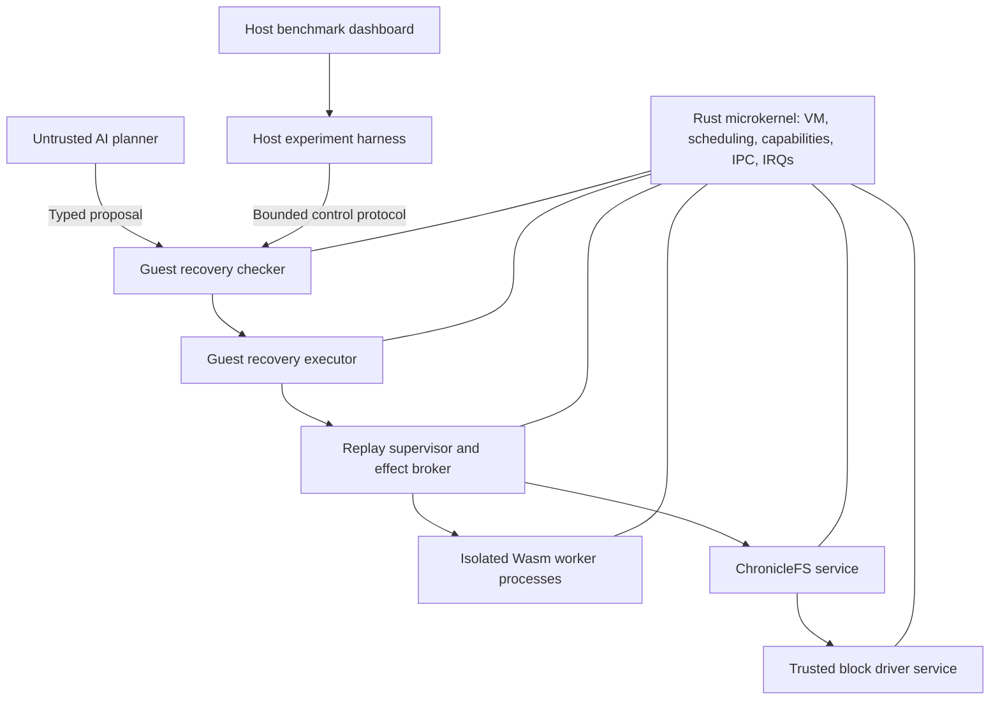

# MnemosyneOS architecture and research plan

Research date: 8 October 2026

The follow-up [deep research review](C:/Users/ludic/Desktop/mnemosyne/docs/deep-research.md) examines 16 papers and develops the recovery protocol in more detail. Its [source-reading guide](C:/Users/ludic/Desktop/mnemosyne/docs/source-reading-guide.md) records targeted inspections across 15 pinned repositories. The findings on Wasmi, storage portability, request retention, and durable publication have been incorporated below.

MnemosyneOS is feasible as a deliberately scoped research prototype. The strongest contribution is the interaction between capability authority, reproducible service execution, and constrained recovery. Building nine disconnected demonstrations would be much less persuasive than showing one stateful workload survive failures while preserving its data and authority boundaries.

The proposed first platform is an x86-64 Rust microkernel in QEMU, with one CPU, isolated userspace services, a small transactional filesystem, and a restricted WebAssembly execution profile. The AI proposes recovery plans; a guest-resident deterministic checker and executor enforce policy. Deterministic replay initially applies to single-threaded Wasm services with fully mediated inputs. General native-process replay, multicore replay, and whole-kernel formal verification are later research projects.

The architecture and numerical limits below are proposed design choices, not measured results. The schedule assumes three contributors with working Rust knowledge and approximately 15 hours per person per week; revise it after the initial feasibility experiments.

## 1 Research question and defensible claims

The central question should be:

> Can a capability-based microkernel recover isolated stateful services through checkpointing and deterministic replay, while allowing an untrusted AI planner to select recovery actions without exceeding a fixed authority and resource policy?

Test three hypotheses separately:

1. A constrained execution profile permits exact reproduction of service-visible events and canonical application state after supported faults.
2. A bounded recovery language can reject forbidden actions and prevent stale plans from executing against changed state.
3. AI planning improves recovery outcomes for some unfamiliar fault combinations compared with strong deterministic recovery policies, after accounting for its latency and cost.

The third hypothesis may be false. That would still be a useful result if the experiment is sound. A simple restart rule is likely to beat an LLM on obvious process crashes. The project should identify where inference adds value rather than presuppose it.

“Capability-secure” should mean that a precisely defined capability model is implemented and evaluated under an explicit threat model. “Deterministic replay” should name the supported execution profile. “Verified recovery” must distinguish runtime policy checking from a mathematical proof of the checker or executor. Even seL4 states its proof assumptions and configuration limits explicitly. [seL4 proof assumptions](https://sel4.systems/Verification/assumptions.html)

## 2 Prior work and the research opportunity

| Work | Established idea | Implication for MnemosyneOS |
| --- | --- | --- |
| [seL4 capabilities](https://docs.sel4.systems/Tutorials/capabilities.html) and [IPC](https://docs.sel4.systems/Tutorials/ipc) | Kernel objects are accessed through capabilities; IPC supports controlled communication and authority transfer. | Study object identity, rights attenuation, endpoint badges, and revocation before designing the ABI. |
| [MINIX 3 reliability](https://wiki.minix3.org/doku.php?id=www%3Adocumentation%3Areliability) | Userspace drivers and a reincarnation server support fault containment and restart. | Service restart is established prior work; the research question must go beyond it. |
| [Theseus, OSDI 2020](https://www.usenix.org/conference/osdi20/presentation/boos) | Rust-based OS structure and reduced cross-component state support evolution and recovery. | State ownership matters as much as the restart mechanism. |
| [rr](https://rr-project.org/) | Practical recording and replay with explicit limits, including single-core execution and restrictions on shared memory. | Concurrency and unmediated shared state are substantial replay costs. |
| [Rollback recovery survey](https://www.cs.rice.edu/~dbj/pubs/csur-rollback.pdf) | Checkpointing, nondeterministic event logging, causal dependencies, and output commitment are distinct problems. | Define a recovery protocol, not just a log file format. |
| [Remus, NSDI 2008](https://static.usenix.org/event/nsdi08/tech/full_papers/cully/cully_html/) | External output is delayed until corresponding state has been replicated. | Output publication must be tied to recoverable state. Remus itself does not provide deterministic computation or software-bug repair. |
| [Btrfs design](https://btrfs.readthedocs.io/en/stable/dev/dev-btrfs-design.html) | Copy-on-write trees and snapshots share unchanged data. | Use a small versioned storage design; avoid copying Btrfs's full feature set. |
| [Crash consistency study, OSDI 2014](https://www.usenix.org/conference/osdi14/technical-sessions/presentation/pillai) | Application recovery depends on subtle persistence properties. | Specify write ordering and flush semantics and test crashes at persistence boundaries. |
| [Proof-carrying code](https://www.cs.cmu.edu/~fox/pcc.html) | Untrusted producers can be separated from trusted checking of safety evidence. | This motivates the planner/checker split, but ordinary JSON validation is not proof-carrying code. |
| [Cedar security model](https://docs.cedarpolicy.com/other/security.html) | Authorization semantics, policy validation, and application integration have separate responsibilities. | Keep the policy model explicit; execution safety requires more than an authorization result. |
| [AIOS](https://arxiv.org/abs/2403.16971) | Agent infrastructure manages LLM-specific services and resources. | Explain MnemosyneOS's hardware protection, kernel capabilities, and service recovery distinctly from agent orchestration. |

A plausible contribution is a recovery protocol that combines replay history, current capability authority, and transactional service publication, with experiments on untrusted AI proposals. This is a candidate contribution, not a claim of being the first system to combine these ideas. A publication would require a broader systematic related-work review.

## 3 Minimum complete system

| Requested feature | Initial complete implementation | Expansion after validation |
| --- | --- | --- |
| Custom Rust microkernel | Boot, traps, frames, address spaces, process lifecycle, timer preemption | SMP and additional hardware |
| Processes and IPC | Separate user address spaces; bounded endpoint messages; call/reply | Priority inheritance, larger zero-copy transfers |
| Capability security | Kernel-owned tables, rights attenuation, stale-handle rejection, revocation | More scalable delegation and revocation |
| Userspace isolation | Init, storage, replay supervisor, checker/executor, Wasm workers | Recoverable drivers and more service classes |
| ChronicleFS | Files/directories, transactions, immutable roots, snapshots and private branches | Online garbage collection and richer file semantics |
| Wasm runtime | Wasmi in a userspace process with a small custom import ABI | Selected WASI support and richer Wasm proposals |
| Checkpoint and replay | Volatile COW process snapshots; safe-point Wasm state export; logged imports | Arbitrary native replay and coordinated service groups |
| AI recovery | Bounded typed plan, deterministic checker, staged execution, rule fallback | More sophisticated planning under the same authority boundary |
| Evaluation dashboard | Host UI reading actual guest events and benchmark artifacts | Interactive experiment comparison |

The minimum convincing demonstration is a stateful Wasm key-value service, two independent clients, an unrelated healthy service, and a recovery supervisor. A request commits a durable update; a later fault kills the service; restoration and replay reconstruct the last committed state; retrying the request produces no duplicate mutation; a forbidden AI plan is rejected; the healthy service continues.

## 4 Platform and toolchain

Use x86-64 with a pinned Limine bootloader, QEMU, Rust `no_std`, a serial console, and GDB. Rust provides the freestanding `x86_64-unknown-none` target; it has no standard library or default allocator. Its kernel-oriented defaults must also be reviewed when producing userspace binaries, including code model and CPU feature choices. [Rust target documentation](https://doc.rust-lang.org/rustc/platform-support/x86_64-unknown-none.html), [Limine](https://github.com/limine-bootloader/limine)

RISC-V is a reasonable alternative if the team already knows xv6 or a course requires it. Choose one ISA before implementation. Supporting both immediately multiplies trap, context-switch, page-table, device, and test work. MIT's xv6 book is useful for understanding traps and OS organization, even though xv6 is not the proposed capability microkernel. [xv6 organization](https://mit-pdos.github.io/xv6-riscv-book/first.html), [traps](https://mit-pdos.github.io/xv6-riscv-book/trap.html)

Proposed initial machine configuration: one vCPU, 256 MiB guest RAM, serial I/O, and a disposable virtual disk. These are development defaults, not minimum system requirements. Use QEMU emulation for repeatable correctness tests. If using accelerated execution or hardware for timing, maintain separate result series with the execution mode recorded.

Pin Rust, boot protocol, QEMU machine and CPU model, dependency lockfile, Wasmi version, feature flags, and disk format. Build a command-line harness before the dashboard. On the Windows development host, either native cross-compilation or an existing WSL Linux setup may be used; choose based on a small build-and-boot experiment. No cloud service is required. Heavy benchmark campaigns or inference require an explicitly approved non-Azure compute arrangement.

## 5 Component architecture and trust boundaries



Kernel responsibilities are protection and bounded mechanism: address spaces, frame ownership, thread scheduling, capability validation, IPC, interrupt delivery, and fault delivery. A minimal debug UART path can remain in the kernel. Filesystem formats, replay policy, Wasm interpretation, and AI inference belong outside it.

The security trusted computing base includes the kernel and the privileged services that enforce the property in question. ChronicleFS, the effect broker, capability bootstrap configuration, and recovery executor are trusted for recovery correctness. Wasmi and its host bindings are trusted for the Wasm sandbox inside a worker; the kernel still isolates that worker from other processes if the runtime fails. A tiny kernel does not imply a tiny total trusted computing base.

For the prototype, trust the virtual hardware and DMA-capable block driver. Userspace placement alone does not contain a malicious driver that can program unrestricted DMA. Strong device isolation requires an IOMMU or a constrained trusted mediation layer; treat that as a separate milestone. Assume no physical attacks, microarchitectural side-channel protection, or resilience to arbitrary kernel corruption.

Workload code, client payloads, application log text, and AI output are untrusted. Fault reports distinguish kernel-observed fields from application-provided strings. A planner can only submit proposals; it cannot change the verifier's policy, invoke privileged syscalls directly, or load new privileged code.

## 6 Kernel implementation

Implement the following in dependency order:

1. Boot handoff, serial diagnostics, panic reporting, physical memory map, and frame allocator.
2. Page tables, kernel/user separation, guard pages, read/write/execute permissions, and safe mapping ownership.
3. Exception and interrupt entry, complete register preservation, timer handling, and a minimal userspace ELF loader.
4. Process lifecycle and context switching, followed by round-robin timer preemption.
5. Capability tables and the first endpoint IPC operations.
6. Fault IPC, process termination, reliable resource cleanup, and userspace service startup.
7. COW mapping support and narrowly scoped checkpoint primitives.

Start with a single-threaded process model. Preempt userspace while keeping early kernel critical paths non-preemptible and bounded. Correctly handle interrupt masking, lost wakeups, blocked senders, cancellation, and process death while IPC is pending. Add explicit IPC queue and per-process memory limits so an authorized caller cannot consume unlimited kernel resources.

Use bounded message copies first. Reserve shared memory for explicitly designed cases; shared writable memory is excluded from the replay profile. Zero-copy IPC complicates lifetime, validation, and replay and should follow a measured need.

Review every unsafe operation with an ownership and lifetime invariant. Particular hazards are page aliases, stale frame references, interrupt entry assembly, user-pointer copies, integer overflow in address ranges, and cleanup racing with IPC. If userspace may use floating-point or SIMD state, save and restore it correctly; otherwise enforce the supported subset. Rust cannot repair an incorrect page table or unsound unsafe abstraction.

Initial syscall families should cover object creation within quotas, capability operations, map/unmap, send/receive/call/reply, process control, and fault subscription. Policy such as “restart this service after three errors” stays in userspace.

## 7 Capability model

Represent a user-visible handle as a slot plus generation, indexing a kernel-owned table. A table entry identifies an object, object generation, object type, rights, and revocation metadata. Handle secrecy is not the security mechanism: userspace cannot create authoritative table entries merely by guessing integers.

Proposed object types are AddressSpace, Frame, Thread, Endpoint, Notification, IRQ, and narrowly scoped service-management objects. A capability can authorize a subset of operations such as send, receive, map, read, write, execute, or control. Creation consumes a fixed quota owned by the creator.

Required invariants:

- A derived capability never contains rights absent from its parent.
- A generation mismatch cannot resolve to a newly allocated object.
- Revocation disables affected descendants and prevents subsequent use through retained mappings or cached authorization.
- Received messages carry kernel-authenticated endpoint identity or badges; a caller-supplied PID is not authority.
- Every mutation and transfer checks the caller's current authority.
- Destroying a process releases its resources without releasing still-referenced objects prematurely.

For a bounded prototype, cap the total number of capability entries and use an explicit derivation structure with a simple bounded traversal for revocation. If revocation cannot complete in one bounded critical section, mark the subtree unavailable before incremental cleanup. A per-object epoch is simpler but coarser: it revokes all capabilities in that epoch, not selectively one derivation subtree. Document whichever semantics are implemented.

Capability restoration is security-sensitive. An old checkpoint must not revive a capability revoked after the checkpoint. Restore references through stable object identities and the current authority policy. Historical capability behavior may be emulated inside a side-effect-free replay environment, but publication must pass current authorization. If the historical and current environments cannot be reconciled, reject promotion or restart under the current manifest.

Specify generation exhaustion rather than silently wrapping and revalidating ancient handles; retiring exhausted slots is acceptable in the prototype. Revocation prevents future access under its declared semantics. It cannot erase data a service legitimately read before revocation or retract an already committed action.

Application services must also avoid becoming confused deputies: access to the filesystem endpoint must carry a scoped namespace or file authority. A privileged service that accepts arbitrary path strings would undermine the kernel's capability discipline.

## 8 Userspace service contracts

Each service manifest declares its binary hash, ABI version, initial capabilities, maximum memory, IPC queue limits, restart policy, replay eligibility, persistent namespace, and health-check contract. Init creates these objects and then hands out only the intended authority.

Use a stable service endpoint owned by the supervisor or broker. Worker generations change on restart, while client handles continue referring to the stable endpoint. Requests contain a client identity, request ID, operation type, and payload digest; replies are associated with the same identity and request ID. Reusing an ID with different content is an error.

At the kernel IPC layer, process death must cancel outstanding interactions and wake blocked callers with a typed result. The broker can hide worker replacement only when its request protocol supports safe retry. Hubris provides a useful generation-aware restart contract; MnemosyneOS should use wider checked generations appropriate to its threat model. [Hubris task-incarnation ABI](https://github.com/oxidecomputer/hubris/blob/e8a43a75ba92a654979218a9527bfe6a4f33e382/sys/abi/src/lib.rs#L13)

Design the first service API around complete request handlers. A handler returns to the runtime at a defined safe point and leaves no pending external operation. A hung or crashed worker cannot cooperate with checkpointing, so recovery uses the last completed checkpoint. Heartbeats supplement actual progress counters and deadlines; a heartbeat alone cannot distinguish useful work from a loop that sends heartbeats.

Crash-only software provides useful precedent for making restart and retry ordinary service behavior. [Crash-Only Software](https://www.usenix.org/conference/hotos-ix/crash-only-software)

## 9 ChronicleFS transactions and snapshots

Build ChronicleFS as a userspace service over a block-device interface that can also run against a host-side fake disk. This permits fast persistence tests before a real driver is complete.

The initial filesystem needs regular files, directories, bounded paths, read/write, create/delete, an explicit transaction API, immutable snapshots, and private writable branches. Exclude POSIX compatibility, memory-mapped files, hard links, compression, encryption, RAID, and online defragmentation. If the first implementation only provides key-value objects, call it a transactional object store until file and directory semantics exist.

Use immutable data blocks and a simple COW metadata tree. Each committed root identifies one complete version. Snapshots pin roots; branches begin from an existing root and write new blocks. The exact metadata tree can be modest: a bounded radix tree or small B-tree is sufficient. Btrfs demonstrates the general COW root design; littlefs illustrates redundancy and checksums for resilient metadata updates. These are design references, not drop-in implementations of ChronicleFS. [Btrfs design](https://btrfs.readthedocs.io/en/stable/dev/dev-btrfs-design.html), [littlefs design](https://github.com/littlefs-project/littlefs/blob/master/DESIGN.md?plain=1)

Proposed commit protocol under a documented block-device model:

1. Reserve space for all data, metadata, and recovery records before starting the transaction.
2. Write new immutable data blocks and metadata, leaving the current committed tree intact.
3. Flush those writes to the persistence boundary.
4. Write the inactive root record, containing generation, root address, format version, and checksum.
5. Flush the root record before acknowledging commitment.
6. On mount, validate both root records and their referenced metadata; choose the newest complete valid committed tree.

Dual root records do not by themselves prove atomicity. State assumptions about torn writes, write reordering, flush guarantees, generation wraparound, and integrity checks. Checksums detect corruption with a residual collision risk; they are not protection against an attacker who can rewrite the disk. A transaction acknowledged after a successful flush must survive the modeled crash. Before acknowledgment, either the old or complete new transaction may appear, but never a partial tree.

Use append-only allocation in the first version, with strict disk quotas and graceful out-of-space behavior. That avoids unsafe block reuse while proving the commit protocol. Add reclamation later by tracing all pinned roots, including recovery checkpoints and fallback superblocks, and reclaiming only unreachable blocks. Snapshot deletion and crash recovery must never free blocks still referenced by any durable root.

A replay worker uses a private filesystem branch. Promoting that branch requires a compare-and-swap against the live namespace version; a global filesystem rollback must not erase another service's later transactions. Initially give each service a dedicated persistent namespace and disallow multi-service transactions.

For a comparison or schedule fallback, evaluate a redb-backed namespace. The inspected revision supports experimental `no_std` through disabled defaults plus `experimental-api-5`, with `alloc` still required. This is a portability experiment, not a completed port or a substitute for implementing promised filesystem semantics. Its storage assumptions and savepoint behavior need explicit adaptation; savepoints do not automatically provide independently writable branches. [Pinned redb manifest](https://github.com/cberner/redb/blob/f403a514fd557f633bd4725248f0d19b434eedff/Cargo.toml), [storage design](https://github.com/cberner/redb/blob/f403a514fd557f633bd4725248f0d19b434eedff/docs/design.md)

## 10 Wasm execution profile

Wasmi is the leading initial candidate because its project documents `no_std` support and fuel metering. Confirm allocator, math, synchronization, and feature requirements against the pinned release with an actual cross-build before committing to integration. Its README's support claims are not a guarantee that every embedding crate works on a new OS. [Wasmi](https://github.com/wasmi-labs/wasmi)

Current source supports resumable out-of-fuel execution through `ResumableCallOutOfFuel`; older discussions saying fuel exhaustion cannot resume are not applicable to this revision. This preserves an in-memory continuation, not a portable serialized interpreter stack. When disabling Cargo defaults for `no_std`, explicitly retain validation. Enable fuel, use the floating-point restriction for the integer profile, and start with eager translation and pinned fuel costs. [Resumable API](https://github.com/wasmi-labs/wasmi/blob/2970aa871cc1001b57b267ccecdcd1e42306199e/crates/wasmi/src/engine/resumable.rs#L384), [feature configuration](https://github.com/wasmi-labs/wasmi/blob/2970aa871cc1001b57b267ccecdcd1e42306199e/crates/wasmi/Cargo.toml), [engine configuration](https://github.com/wasmi-labs/wasmi/blob/2970aa871cc1001b57b267ccecdcd1e42306199e/crates/wasmi/src/engine/config.rs)

Define a small `mnemosyne_v1` import interface for request receipt, replies, scoped storage operations, logical time, random bytes, and structured diagnostics. Route every import through an audited host binding. A full WASI implementation is unnecessary for the first research workload.

Proposed deterministic profile:

- One Wasm worker per process, one thread, one request handler active at a time.
- Fixed preallocated linear memory; reject memory/table growth initially.
- Integer operations first; reject floating-point instructions and SIMD in the initial module validator.
- No shared memory, threads, direct devices, native plugins, or ambient filesystem/network access.
- Explicit import allowlist; deterministic event sequence; pinned engine and module hashes.
- Fuel limits on guest execution, separate budgets on host work, and bounded message sizes.

WebAssembly is not automatically deterministic. The Wasmtime documentation identifies nondeterministic imports, floating-point NaNs, relaxed SIMD, and memory/table growth as issues. Its configuration APIs are Wasmtime-specific; use the document as a checklist and enforce an equivalent contract in the chosen Wasmi embedding. [Deterministic Wasm execution](https://docs.wasmtime.dev/examples-deterministic-wasm-execution.html)

Fuel counts execution work; it does not impose a wall-clock deadline on an arbitrary blocking host function. Storage calls, parsing, serialization, and other imports require independent size limits, cancellable waits, and timeouts. Timer preemption protects other processes even when a worker misbehaves. Fuel-based and time-based interruption have different determinism properties. [Wasmtime interruption](https://docs.wasmtime.dev/examples-interrupting-wasm.html)

For persistent portable checkpoints, require a service ABI that exports all mutable application state at handler boundaries. Alternatively, capture every mutable Wasm global, memory, and table supported by the profile. Saving only linear memory is insufficient. An arbitrary suspended interpreter stack is not assumed to be serializable through Wasmi's public API; validate that separately or avoid it through safe-point checkpointing.

## 11 Checkpoint state and lifecycle

A checkpoint is a consistency record, not just copied RAM. Its manifest should bind:

| State | Required treatment |
| --- | --- |
| Worker memory and registers | Capture address-space mappings, registers, stack, and applicable FPU state for a native COW snapshot. |
| Wasm application state | Capture all state covered by the declared service ABI; include schema version. |
| Kernel resources | Record logical references and restoration rules for handles, quotas, mappings, and process state. |
| Runtime state | Include allocator/runtime state when restoring the entire process; reconstruct it explicitly for logical Wasm checkpoints. |
| Filesystem | Pin the exact namespace root corresponding to the checkpoint. |
| Events | Record next event sequence, durable log frontier, and pending-request boundary. |
| Effects | Record the committed-effect frontier; the live effect ledger remains monotonic across restores. |
| Compatibility | Bind kernel ABI, module, runtime, policy, and snapshot format versions. |

At a safe point, stop admission of new requests, finish or explicitly abort the current transaction, freeze the worker, capture the corresponding storage and log references, establish COW mappings, and publish the checkpoint manifest only after the required dependencies are available. Resume admission after the broker has installed the new generation consistently.

For COW, clear writable permissions on every alias of a captured frame, maintain reference counts, and invalidate relevant TLB entries before execution resumes. On the next write fault, allocate and copy a page, update the writer's mapping, and preserve the snapshot's reference. Distinguish genuine read-only violations from COW faults. Reserve enough memory for worst-case dirtying or reject checkpoint creation; memory pressure must not cause unbounded kernel allocation.

Start with one retained COW checkpoint per worker. Add multiple checkpoints only after frame lifetime tests pass. COW reduces copying at checkpoint creation; it still requires mapping work, bookkeeping, later write faults, and potentially a second copy of every dirty page.

There are two different durability levels:

- **Service-crash recovery:** the kernel, broker, and RAM checkpoint survive while a worker fails. This is the first target.
- **Machine-restart recovery:** logs and logical application checkpoints have been persisted to ChronicleFS and can reconstruct a new worker after boot. This requires an explicit serialization and restore protocol.

Keeping COW pages in RAM does not satisfy the second level. Persisting arbitrary native memory introduces pointer, handle, and runtime-version issues that the initial safe-point Wasm ABI avoids.

## 12 Event recording and deterministic replay

Use a per-service ordered stream owned by a trusted broker. A proposed event includes format version, service identity and generation, sequence number, event type, request ID, request digest, response or payload bytes, logical time, and integrity metadata. Keep the stream in a different protection domain from the worker. A hash chain can reveal accidental changes or changes relative to a trusted anchor; it is not independent tamper protection if an attacker can rewrite the chain and its anchor.

Record all service-visible nondeterminism: incoming message order and contents, time/random results, storage-read results or stable snapshot references, timeout decisions, cancellation, allocation failures exposed through imports, and host-call error values. Also record expected outgoing requests and replies so replay can detect divergence. Freeze capability topology during each recorded epoch initially; dynamic capability transfer during replay is an advanced extension.

The replay engine follows this protocol:

1. Restore a compatible checkpoint into an isolated worker and attach a private storage branch.
2. Disable live input delivery and external effect publication for that worker.
3. At each import or receive, check event type, sequence, and request digest, then return the recorded result.
4. Compare attempted output and mutation records with the recorded sequence; do not reissue historical committed effects.
5. At agreed handler boundaries, compare canonical state and output digests with the reference execution.
6. Stop immediately on missing events, extra imports, incompatible versions, or mismatched outputs.
7. Promote only at a completed consistency frontier after current policy and health checks succeed.

Define the fidelity target as equal service-visible event streams and canonical application state at declared boundaries for the same checkpoint, program, engine, and recorded inputs. Raw process-memory equality is generally too strong because irrelevant allocator state, padding, and addresses may differ. Canonical state must nevertheless include every field that influences future application behavior.

Kernel preemption can coexist with this contract: it changes when a single-threaded worker runs, but cannot change its observed inputs if the broker controls them and the worker has no unmediated timing or shared-memory access. This does not reproduce the same instruction-level interrupt history. General native code can read clocks or hardware randomness without the service ABI, so kernel isolation alone does not make it replayable. Native replay requires additional instrumentation, virtualization, or a carefully trusted code subset.

QEMU record/replay is useful for debugging the whole experimental machine and reproducing kernel failures. It records nondeterministic device events under instruction-counted execution. Treat it as a separate testing facility; it does not implement the proposed in-OS per-service recovery protocol. [QEMU record/replay](https://www.qemu.org/docs/master/system/replay.html)

## 13 Effects and recovery consistency

Suppose a worker increments a persistent counter and replies “done.” If it later restores an older checkpoint and repeats the increment, the final count is wrong even when the repeated computation is perfectly deterministic. The broker and filesystem must jointly control publication.

For the first workload, atomically commit the data mutation and an effect record keyed by service identity, client identity, and request ID. Store the reply in that record. A retry returns the committed reply; a replay reconstructs application state while suppressing the historical mutation against the live filesystem. Preserve the request digest to detect conflicting reuse of an ID.

Request identities also need a client epoch and monotonic sequence allocation outside worker rollback. Reclaim completion records only after persisting an acknowledgment floor or retiring the client epoch; old retries must then be rejected. A retention timer alone permits a delayed request to execute twice after its record is deleted. Initially prefer bounded explicit sessions and backpressure over distributed lease machinery. [RIFL request completion and reclamation protocol](https://web.stanford.edu/~ouster/cgi-bin/papers/rifl.pdf)

If a handler fails before commit, discard its tentative storage transaction and restore its application state before admitting the next handler. Aborting a filesystem transaction alone does not undo changes already made to Wasm memory.

Persist the input determinants needed for recovery before making their consequences externally visible. Tie the data root, result record, and durable replay frontier together in the storage protocol. Reserve space for all three before accepting the transaction. A logging failure must cause backpressure or an explicit error, not silent loss of replay coverage.

During replay, reproduce historical writes only on the private branch and compare them with the effect history. Before promotion, require the candidate to account for every acknowledged operation through the live committed frontier; compare its reconstructed namespace against the authoritative committed version. With service admission paused, promote only if the expected live version still matches. A mismatch requires rejection or explicit application-specific reconciliation. Suppressing duplicate live writes does not permit promoting an outdated filesystem root.

For external network effects, a durable outbox alone does not guarantee exactly-once behavior: failure may occur after the receiver acted but before acknowledgment was recorded. Require receiver-side idempotency/deduplication or declare weaker delivery semantics. The first demonstration should use local transactional effects and clients with stable request IDs. Output commitment and irreversible external actions are central issues in the rollback-recovery literature. [Rollback recovery survey](https://www.cs.rice.edu/~dbj/pubs/csur-rollback.pdf)

Do not rewind the live capability revocation state, effect ledger, or security audit trail along with a service. These are monotonic authorities outside its rollback domain. A service restore can reduce application state while the system continues to remember already-committed effects and revoked rights.

Arbitrary independently checkpointed service graphs can require rollback of healthy peers. The initial brokered service model avoids exposing speculative effects across that boundary. If direct peer interactions are later allowed, add coordinated checkpoints or a specified message-logging protocol; independent snapshots alone are insufficient.

Replay also reproduces deterministic bugs. If the same malformed request reliably crashes the service, exact replay will crash again. Recovery may quarantine that request, restore an earlier compatible state, or select a preapproved service version. Such an intervention creates a new execution branch and must be recorded as recovery, not represented as faithful replay of the old execution. It cannot erase an already acknowledged external effect.

## 14 Recovery language and checker

Use a versioned, bounded AST serialized as strict JSON or a similarly simple format. Reject unknown fields, duplicate keys, invalid integers, excessive nesting, oversized strings, and unsupported versions. The runtime language should have no arbitrary code, shell commands, recursion, unbounded loops, URL fetches, or unrestricted file paths.

A compact initial action set is Quarantine, RestoreCandidate, ReplayCandidate, CheckHealth, PromoteCandidate, and AbortCandidate. Restart can be a defined composition of these primitives. References identify preexisting service manifests, checkpoints, and approved binaries; the planner cannot provide new executable bytes.

Illustrative proposal, not an implemented API:

```json
{
  "version": 1,
  "incident_id": "incident-42",
  "service_id": "kv-worker",
  "expected_service_generation": 17,
  "expected_policy_epoch": 9,
  "checkpoint_id": "checkpoint-108",
  "limits": {
    "max_actions": 5,
    "max_replay_events": 2000,
    "max_extra_pages": 2048,
    "max_guest_fuel": 5000000
  },
  "actions": [
    {"op": "quarantine"},
    {"op": "restore_candidate"},
    {"op": "replay_candidate", "through_event": 12000},
    {"op": "check_health", "check_id": "kv-consistency-v1"},
    {"op": "promote_candidate"}
  ]
}
```

The limit values are examples. The checker must derive actual upper bounds from the authenticated system inventory and policy, not believe the planner's declarations. It obtains the checkpoint's event frontier and checks that replaying through event 12000 fits the permitted event count.

Verification stages should be:

1. Parse within strict resource bounds and validate the AST.
2. Resolve every reference against authoritative live state.
3. Check incident scope and the executor's target-specific capability authority.
4. Check the action sequence against a recovery state machine.
5. Simulate resource reservations and authority changes through every intermediate state.
6. Validate checkpoint integrity, compatibility, pinned dependencies, and available rollback resources.
7. Produce a checked plan bound to a canonical plan hash, policy epoch, service generation, and reservation token.

Execution occurs under per-service synchronization. Validate current generations and policy at each sensitive operation's linearization point, serialized against revocation and conflicting publication. A check immediately before a separate operation still leaves a race unless the two are coupled. Security revocation must invalidate pending plans. Two recovery plans must not race to promote different generations.

Suggested default policy: recovery can restore only authority still permitted by the current service manifest; it cannot grant new authority. Therefore a recovered worker's effective rights remain a subset of the currently authorized rights for that service. A later administrative mechanism may revise the manifest, but it is outside the AI planner's action set.

Budget both per-plan and aggregate behavior. Cap attempts per incident and per service over a window, apply backoff, and bound diagnostic and log storage. Otherwise many individually bounded plans can create an unbounded restart storm. Use checked arithmetic when accumulating page, event, action, and fuel limits.

The checker determines whether a plan belongs to an allowed transition system; formal verification can establish that this check satisfies its specification. It cannot infer that arbitrary business data is correct or guarantee that a health check will succeed. Health-check definitions must be trusted, bounded, and more meaningful than “the process started.”

## 15 Staged execution and rollback

Use the state machine Healthy → Quarantined → CandidatePrepared → Replaying → Validated → Promoted. Failure before promotion leads to CandidateAborted and a retained quarantined or recoverable previous state. Keep old resources pinned until promotion is committed and cleanup is safe.

Promotion should commit one authoritative durable catalog record binding the worker generation, permitted namespace root, candidate state, replay frontier, module/profile identity, and expected authority version. Rebuild in-memory routing from that catalog after a supervisor restart. Fence old generations at every effect-producing interface, including storage. Recheck current authority as part of the publication transaction; define restart behavior before and after its commit point and inject failures between every step.

Capability revocations that must survive a machine restart need their own persistent authority protocol. Keep it outside service rollback. An in-memory generation counter or recovery lease does not by itself preserve revocation across reboot.

Rollback availability means that the executor has retained the actual checkpoint, log segment, namespace root, and resources needed to resume an allowed previous state. A boolean field in an AI proposal is not evidence of availability. Preflight restore compatibility, validate hashes, and reserve resources before attempting destructive changes.

After an external effect becomes visible, rollback cannot generally undo it. The first protocol should preserve all previously acknowledged effects and abandon candidates before new external publication. Later compensation workflows must have separately specified semantics.

If the supervisor, filesystem, or kernel fails, service-level COW recovery alone is insufficient. Initially use a controlled whole-system reboot and durable recovery where supported, and count that event separately. Nested recovery of the entire trusted control plane is outside the first prototype.

## 16 What to formally verify

Keep a small pure recovery core separate from I/O and kernel code. It should accept a typed plan and an immutable description of system state, and return either a rejection reason or a checked transition sequence. The same core can run in host tests and the guest.

Start with four properties:

1. **Authority preservation:** every accepted transition preserves the current service authority ceiling.
2. **Resource preservation:** reserved and consumed resources remain within policy limits, including intermediate states.
3. **Promotion precondition:** a candidate cannot become live without the required successful replay and trusted health-check evidence for that exact generation.
4. **Staleness rejection:** a plan checked for one policy epoch or object generation cannot execute after that value changes without revalidation.

Also verify parser bounds, rights-mask subset checks, generation handling, and arithmetic. A bounded model of the capability table and recovery state machine can explore short interleavings, including revocation during verification and competing recovery attempts.

Use Kani for selected Rust functions and bounded state exploration, with the harness assumptions and unwind bounds committed alongside results. The supported proof domain must be explicit; small bounded exploration is not a proof for arbitrary system sizes. Verus is an option for a deductive proof of the pure checker or transition relation, but it supports a subset of Rust and retains toolchain assumptions. Choose one primary formal tool after a small feasibility exercise. [Kani](https://model-checking.github.io/kani/), [Kani loop contracts](https://model-checking.github.io/kani/reference/experimental/loop-contracts.html), [Verus](https://verus-lang.github.io/verus/guide/)

A theorem about a model does not automatically cover an unrelated executor implementation. Keep the checked representation and transition functions shared where possible, and state which external operations are trusted to satisfy their contracts. End-to-end formal verification of the microkernel is not part of the proposed schedule.

## 17 AI planner design and evaluation

Run the planner outside the guest initially. A constrained host adapter sends a bounded structured incident summary to the selected model and returns only the candidate AST. The guest remains the authority boundary. This avoids making a network stack, TLS implementation, and inference runtime prerequisites for the OS research.

The planner sees fault class, service manifest, current generation, capability summary, resource usage, available checkpoints, recent event summaries, previous attempt outcomes, and allowed action definitions. Application log text is labeled untrusted and cannot alter the schema or policy. Do not provide shell access or privileged execution tools.

Use an existing approved inference provider or separately approved non-Azure hardware. Training a model is unnecessary. A live AI experiment should save model identifier, prompt template, exact input/output, sampling configuration, latency, token use, and checker result. Replaying saved proposals tests the control plane reproducibly but must be labeled separately from fresh-model planning performance.

Compare at least these policies:

| Policy | Purpose |
| --- | --- |
| Cold restart from durable state | Basic availability baseline |
| Latest-checkpoint restore and fixed replay policy | Benefit of checkpointing and replay |
| Handwritten decision tree using the same observations | Strong non-AI diagnosis baseline |
| AI planner through the same checker and executor | Incremental planning value |
| Fault-aware oracle choosing among the same actions | Experimental upper bound using privileged fault knowledge |

Do not make the deterministic baseline artificially weak. It should handle obvious traps, fuel exhaustion, storage errors, and repeated failures. Use held-out combinations of faults, workload sizes, and checkpoint age. Repeated queries to an LLM are separate trials; do not discard invalid proposals or timeouts from the denominator.

Measure plan validity, checker acceptance, rejection reasons, successful recovery, inappropriate intervention, latency, cost, and time spent unavailable. Inject malicious instructions into workload logs to test whether planner behavior changes and whether the checker still enforces policy. A compromised planner should reduce availability at worst within the defined quotas, not gain new authority; this remains a property to demonstrate under the stated model.

## 18 Fault injection campaign

Build named fault hooks into debug/test builds and expose them only through a test authority. Exclude that authority from normal workload manifests. Generate experiment cases from seeded schedules so every failure can be reproduced.

| Fault class | Injection examples | Required observation |
| --- | --- | --- |
| Worker crash | Invalid memory access, explicit abort, Wasm trap | Worker is contained; healthy peer continues; recovery reaches a valid frontier. |
| CPU exhaustion | Infinite loop, handler exceeding fuel | Worker is preempted or trapped; queues and recovery attempts remain bounded. |
| Memory exhaustion | Allocator failure, COW reserve exhaustion | Predictable failure; kernel and other services retain resources. |
| Capability misuse | Forged/stale handles, excessive rights, transfer after revoke | Kernel rejects the operation with no unauthorized state change. |
| Replay corruption | Missing, reordered, changed, or truncated event | Replay stops before promotion and identifies the mismatch. |
| Persistent corruption | Torn root record, corrupt metadata block | Filesystem detects invalid state or falls back according to its declared fault model. |
| Persistence crash | Failure before/after each write and flush | Mounted state satisfies the transaction atomicity and durability oracle. |
| Duplicate request | Retry before response, after commit, and after recovery | One committed mutation and the same reply for the same request content. |
| Stale plan | Revoke authority or replace worker after checking | Pending plan is rejected or safely revalidated. |
| Recovery interruption | Crash between preparation, replay, validation, and promotion | No partial promotion; retained state remains recoverable. |
| Malicious proposal | Unknown op, excessive budget, unauthorized service, stale checkpoint | Checker rejects within bounded time and memory. |
| Persistent software bug | Specific input always crashes the handler | Reproduction is distinguished from repair; retry storm is prevented. |

For filesystem testing, a host-side device model must simulate allowed reordering, dropped unflushed writes, and torn writes. Killing QEMU at random moments is supplementary evidence, not exhaustive crash-consistency testing. Exhaustively enumerate persistence outcomes only for suitably small transactions; use seeded sampling for larger cases and disclose coverage.

Memory corruption inside a worker can alter legitimate output before the system notices. Capabilities contain access; they do not guarantee application correctness. Use workload-specific consistency checks and a reference model, and report undetected incorrect results. Do not equate “process remained alive” with successful containment or recovery.

## 19 Benchmark methodology

| Metric | Experiment | Report |
| --- | --- | --- |
| IPC cost | Same-core ping-pong across address spaces, varying payload size and contention | Round-trip latency distribution, throughput, context switches; identify exactly what is timed. |
| Capability cost | Valid, wrong-rights, stale, and revoked lookup; varying table/derivation sizes | Incremental cycles or elapsed time and revocation cost. |
| Wasm overhead | Same algorithm and inputs as a native userspace build | Startup, steady-state throughput, memory, import cost, fuel overhead. |
| Checkpoint cost | Vary mapped pages, dirty-page fraction, retained snapshots | Pause time, later COW faults, total runtime slowdown, peak extra memory. |
| Storage cost | Transaction sizes, sync frequency, snapshot/branch operations | Commit latency, write amplification, retained space, mount recovery time. |
| Replay fidelity | Replay saved histories across repeated executions and compatible configurations | Exact event/state match fraction, first mismatch, unsupported-case count. |
| Logging cost | Compare identical workloads with logging enabled/disabled | Throughput loss, latency increase, bytes/event, flush traffic. |
| Containment | Run healthy peer while injecting a target fault | Peer latency, progress, state integrity, unauthorized-access results. |
| Recovery | Repeat fault cases across policies | Detection, planning, checking, restore, replay, validation, promotion, total recovery time. |
| Checker | Plan length and inventory size; malformed and adversarial input | Acceptance/rejection accuracy, p50/p95/p99 latency where sample size supports it, maximum memory. |

Measure mean recovery time, but also median, tail, success rate, and unrecovered/time-limited trials. Define recovery completion as resumption of correct useful service according to the workload oracle. Reporting the mean of successful trials alone can conceal a poor recovery policy.

Use within-system ablations to isolate costs. An insecure build that skips capability checks may be used only as a controlled laboratory measurement, with no security claim. Cross-OS comparisons require matched hardware, workloads, semantics, compiler options, and persistence settings; otherwise treat them as context, not direct rankings.

Start with a pilot to estimate variance, then preregister the final repetition count. Thirty independent process/VM runs per comparison can be an initial planning value; it is not automatically sufficient for reliable tail estimates. Collect enough requests within runs for latency distributions, and use independent runs as the statistical unit for confidence intervals. Pair policies on the same fault seeds and alternate execution order to reduce drift.

Record code commit, toolchain, CPU and QEMU configuration, execution mode, disk cache/flush settings, workload hash, input seed, warmup, checkpoint interval, and raw observations. Host wall time measures experienced VM latency. Emulated guest cycles do not establish real hardware cycle cost; instruction-counted execution is particularly unsuitable as an unqualified hardware performance claim.

Measure overhead in the correct direction: latency overhead is `(instrumented / baseline - 1) * 100%`; throughput loss is `(1 - instrumented / baseline) * 100%`. Do not promise a percentage before measuring it.

Checkpoint interval is a tunable tradeoff. More frequent checkpoints may reduce replay work but increase pauses, write faults, and storage traffic. For a simple sizing model, expected replay length is approximately request rate times half the interval only if failures are uniformly distributed and replay costs are sufficiently stationary; validate those assumptions experimentally.

## 20 Dashboard and evidence artifacts

Keep the dashboard on the development host. The guest emits versioned events over a bounded serial or similar channel; a collector stores raw records and presents process state, capability denials, checkpoint generations, replay divergence, recovery actions, and benchmark distributions.

Show the distinction between live events, recorded experiments, and saved AI proposals. Every chart should link to raw observations and the machine configuration. Track dropped telemetry explicitly. Diagnostic logging is different from the correctness-critical replay log: a dropped dashboard event may be acceptable, while an unrecorded nondeterministic input invalidates the replay contract.

Provide a CLI to run the same demonstrations without the UI. Build the dashboard after the benchmark result format and test runner exist. A visually polished dashboard cannot compensate for an ambiguous correctness oracle.

## 21 Repository design

Proposed structure:

```text
kernel/                  architecture, VM, traps, scheduler, capabilities, IPC
crates/abi/              versioned syscall and IPC definitions
crates/cap-model/        pure authority model and test helpers
crates/chronicle-core/   filesystem structures and device-independent logic
crates/replay-core/      event format, replay checking, checkpoint manifests
crates/recovery-core/    typed plans, policy checks, transition model
user/init/               bootstrap and manifest loading
user/block/              trusted device driver
user/chroniclefs/        filesystem service wrapper
user/supervisor/         stable endpoints, effect broker, recovery execution
user/wasm-worker/        Wasmi embedding and import bindings
workloads/               reference services and deliberate faulty variants
host/runner/             QEMU lifecycle and experiment execution
host/planner/            model adapter and deterministic baseline
host/dashboard/          experiment viewer
tests/                   host tests, guest integration tests, crash campaigns
verification/            harnesses, specifications, bounds and proof results
docs/                    architecture decisions, threat model, protocols
results/                 experiment manifests and pointers to raw artifacts
```

Keep core libraries usable in both host tests and `no_std` service builds. Use an `xtask` or equivalent command wrapper for builds, disk-image construction, boot tests, and experiment manifests. This is a proposed layout; no kernel or runtime implementation has been created by this research task.

## 22 Delivery stages and acceptance gates

For a three-person team contributing roughly 15 hours each per week, a 24-week plan represents approximately 1080 person-hours. This is a planning estimate for the constrained prototype, not a delivery guarantee. New systems programmers should allow substantial extra learning time. A solo semester should target the core OS plus one recovery workload and reduce optional features.

| Weeks | Deliverable | Gate before proceeding |
| --- | --- | --- |
| 1–2 | Architecture contracts and host feasibility experiments | Restricted Wasm service can be reconstructed; storage crash model and checker core are executable. |
| 3–5 | Boot, memory, traps, userspace, preemption | Two isolated processes run; faults and bad pointers cannot corrupt a healthy peer. |
| 6–8 | Capabilities, IPC, service lifecycle | Stale handles, rights attenuation, revocation, cancellation, and teardown tests pass. |
| 9–11 | ChronicleFS and device integration | Transactions and snapshots pass declared crash-consistency tests. |
| 12–14 | Wasm worker, COW checkpoints, broker | Stateful worker restores; all required runtime and kernel state is accounted for. |
| 15–17 | Replay and effect commitment | Exact supported-profile replay; duplicate requests do not duplicate committed effects. |
| 18–20 | Recovery DSL, staged executor, selected proofs, AI adapter | Stale/unauthorized plans rejected; recovery interrupted at each stage remains consistent. |
| 21–24 | Fault campaign, dashboard, analysis, report | Reproducible artifacts, baseline comparisons, disclosed failures and limitations. |

These stages overlap: host storage and policy work can progress while the kernel is being built. Suggested team ownership is kernel/IPC, storage/replay, and recovery/verification/evaluation, with cross-review of shared contracts. This is a human team plan, not a requirement to run autonomous subagents.

Add stop-or-reduce-scope gates. If stable isolated userspace does not exist by week 5, reduce device/UI work. If replay fails to reproduce a small host workload in weeks 1–2, resolve the execution contract before writing kernel checkpoint machinery. If storage durability is incomplete, explicitly deliver service-crash recovery with RAM checkpoints while retaining a separately scoped filesystem experiment; do not claim machine-restart recovery.

A seL4-based implementation is a valuable fallback if the recovery research becomes more important than a custom kernel. It would preserve much of the service and verifier research, but it changes the stated custom-microkernel deliverable and should be agreed with the teacher. Linux-hosted tests are a development technique; by themselves they do not fulfill the OS implementation requirement.

## 23 First two weeks of concrete work

The highest-value early experiments are small and independent of a finished OS:

1. **Wasm replay experiment:** use a pinned Wasmi build to execute a bounded integer key-value service. Route clock, random, and storage calls through a fake broker. Save logical state at handler boundaries, replay a request stream, compare canonical state and outputs, and deliberately remove one event to ensure divergence is detected.
2. **Checkpoint completeness experiment:** add mutable globals and any permitted tables to the workload. Confirm that the selected export/import approach restores all future-relevant state. Verify that unsupported features are rejected at admission.
3. **Filesystem experiment:** implement a tiny immutable root plus dual root-record prototype against a fake block device. Enumerate crashes and allowed persistence outcomes for small commits before adding complex directory operations.
4. **Policy experiment:** implement a pure checker for the six recovery primitives, generation checks, and resource sums. Test old-policy plans, revoked capabilities, oversized plans, integer overflow, and conflicting promotion attempts.
5. **Kernel experiment:** boot a minimal Rust image, print a serial marker, handle a timer, and exit QEMU with a structured test result. This validates the build environment without pretending the full OS is already underway.

Deliver four short architecture decisions at the end: ISA/toolchain, capability semantics, replay profile/effect protocol, and recovery transaction/verification scope. Their purpose is to settle interfaces that otherwise cause expensive rewrites.

## 24 Teacher-facing proposal adjustments

The supplied title is ambitious and usable if the meaning of “verified” is defined. If the initial deliverable is runtime policy checking with selected formal properties, a more precise alternative is:

> MnemosyneOS: Design and Implementation of a Capability-Based Microkernel with Deterministic Service Replay and Policy-Verified AI-Assisted Recovery

If the original title is retained, explicitly state that verification concerns declared recovery properties under assumptions; it does not mean the entire kernel or AI's reasoning has been formally verified.

Suggested abstract:

> MnemosyneOS is a research-oriented 64-bit Rust microkernel for isolating and recovering untrusted service workloads. The prototype provides virtual memory, preemptive scheduling, capability-mediated inter-process communication, isolated userspace services, a transactional snapshotting filesystem, and a WebAssembly runtime. Replay-enabled services follow a restricted execution profile in which observable nondeterministic inputs are mediated and recorded. Service checkpoints combine memory or serialized application state with filesystem versions and event-log positions, while an effect broker prevents replay from repeating previously committed operations. An untrusted AI control plane proposes recovery actions in a bounded typed language. A deterministic checker validates authority, resource limits, state preconditions, and available recovery state before a staged executor applies the plan. Selected checker properties are targeted for formal verification. Evaluation compares deterministic and AI-assisted recovery policies using injected faults, measuring IPC and capability overhead, Wasm performance, checkpoint and logging cost, replay fidelity, failure containment, recovery success, and recovery latency.

The project succeeds when the full recovery path is reproducible, the authority and consistency claims survive adversarial tests, and the experimental results explain both successful recovery and its limits.
