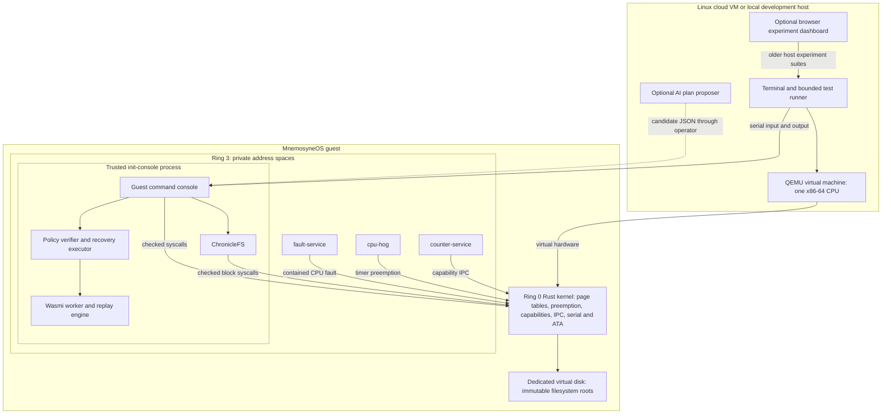
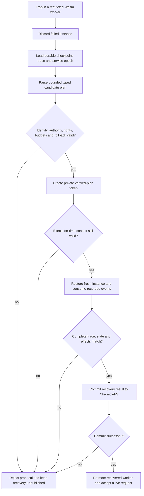

# Review I guide

Prepared for the supplied Review I rubric on 9 October 2026. Implementation
baseline: `f09a43143e36db9d0b38b7fc7d69b6cb51d37059`. The current implementation
is a bootable research OS with an executable recovery demonstration.

## Review requirements and evidence

| Requirement | What to present | Evidence / readiness |
| --- | --- | --- |
| Problem statement | Recover a failed service while preserving state, current authority and peer progress | Defined below |
| Objectives | Isolation, preemption, bounded IPC, persistent snapshots, replay and checked recovery | Implemented prototype objectives below |
| Literature/background | seL4, Theseus, RIFL, CrashMonkey/B3 and LLM-Modulo | Five primary sources with design implications below |
| System design | Kernel mechanisms, trusted userspace services, restricted Wasm workload and host tooling | Current design below; [implementation limits](implementation-status.md) |
| Architecture | Actual process boundaries and host/guest boundary | Diagram below |
| Algorithm/flowchart | Scheduling, capability IPC, storage commit, checkpoint and checked replay | Algorithms and flowchart below |
| Module division | Four suggested workstreams, assigned to actual team members | **Names and agreed ownership pending** |
| Minimum working prototype | Boot the OS and execute `demo` in its serial console | Six guest stages pass in the [recorded run](evidence/guest-demo.log) |
| At least 60–70% implementation | Compare completed acceptance criteria with the agreed final project scope | **Full-project percentage not established**; do not infer it from demo coverage |
| Executable core | Live guest demo, persistent file after reboot, resumed KV request | [Two-boot acceptance](evidence/guest-reboot.log); commands below |

The working-prototype and executable-core gates have evidence. Team attribution
and an agreed completion denominator remain open. These materials should not be
presented as proof that every Review I requirement is already satisfied.

## Opening explanation

“MnemosyneOS is a small Rust operating system that boots on virtual x86-64
hardware. It has its own kernel, task scheduler, protected user processes,
capability-checked IPC, persistent filesystem and command console. Our research
question is whether a failed service can recover predictably by restoring a
checkpoint and replaying recorded inputs, while current permissions and resource
limits still apply. The current prototype demonstrates that path for a native
counter service and a restricted WebAssembly workload.”

The original proposal title remains **MnemosyneOS: Design and Implementation of
a Capability-Secure Microkernel with Deterministic Service Replay and Verified
AI-Assisted Recovery**. For a status presentation, the more precise short title
is **MnemosyneOS: A Capability-Based Research OS with Deterministic Service Replay
and Policy-Checked Recovery**. “Verified” here means a deterministic runtime
policy check. A machine-checked kernel or recovery proof has not been completed.

## Problem statement

A service can fail after changing state or processing an input. Restarting its
code alone loses that state. Replaying an incomplete history can produce a
different result, and restoring old handles can conflict with current authority.
A recovery controller also needs limits: a plausible recovery proposal must not
grant itself extra rights or execute an unbounded program.

This project investigates a bounded solution: isolate workloads, save a known
state, record relevant nondeterministic inputs, reject invalid plans, and recover
privately before exposing the recovered worker. The prototype compares effects
in memory. Preventing duplicate effects at an external recipient remains outside
the implemented protocol.

## Objectives and executable acceptance

| Objective | Acceptance in the current prototype | Guest demonstration |
| --- | --- | --- |
| Keep tasks isolated and responsive | Private ring-3 mappings; timer preempts a task that never yields | `ps`, `ipc-demo`, `fault-demo` |
| Enforce authority at the syscall boundary | Typed handles and checked user buffers reject invalid operations | `cap-demo` |
| Preserve persistent state | Files and immutable roots survive reboot; snapshot restore returns old contents | `demo`, `ls`, `snapshots`, reboot and `cat` |
| Recover native service state | COW checkpoint, register/page restore, stale endpoint rejection and identical replayed replies | `cow-demo` |
| Recover a Wasm worker deterministically | Restore a durable bundle in a fresh instance; consume all events; compare state/effects; accept another request | `wasm-demo`, `recover`, `kv-add 1 2` |
| Check recovery proposals | Reject identity, authority, privilege, budget and rollback violations before execution | `verify-plan`, automated rejection test |
| Produce reproducible evidence | Bounded two-boot guest acceptance and failure-oriented shared-library tests | Host commands below |

## Literature and background

| Primary source | Relevant idea | Application and boundary in MnemosyneOS |
| --- | --- | --- |
| Klein et al., **seL4: Formal Verification of an OS Kernel**, SOSP 2009 ([paper](https://sel4.systems/Research/pdfs/sel4-formal-verification-os-kernel.pdf)) | Small kernel mechanisms and precisely stated correctness obligations | Capability and address-space boundaries guide the design. This implementation does not inherit seL4's proof or code. |
| Boos et al., **Theseus: an Experiment in Operating System Structure and State Management**, OSDI 2020 ([paper page](https://www.usenix.org/conference/osdi20/presentation/boos)) | Component state ownership affects recovery and evolution | Separate native service state makes a narrow recovery experiment manageable. Several privileged services still share init. Theseus uses a different OS structure. |
| Lee et al., **Implementing Linearizability at Large Scale and Low Latency**, SOSP 2015, RIFL ([paper](https://web.stanford.edu/~ouster/cgi-bin/papers/rifl.pdf)) | Retries need persistent operation/completion identity to avoid repeated committed effects | Comparing replayed effects alone does not establish exactly-once external delivery. Such a protocol is future work. |
| Mohan et al., **Finding Crash-Consistency Bugs with Bounded Black-Box Crash Testing**, OSDI 2018 ([paper page](https://www.usenix.org/conference/osdi18/presentation/mohan)) | Bound a crash-test space and check recovered persistent state | Shared filesystem tests interrupt commit operations and corrupt headers/payloads. The project has not ported CrashMonkey or reproduced its evaluation. |
| Gundawar et al., **Robust Planning with Compound LLM Architectures: An LLM-Modulo Approach**, arXiv:2411.14484v1, 2024 ([paper](https://arxiv.org/html/2411.14484v1)) | Separate candidate generation from external validity checks | The model proposes a typed action; trusted code checks it. A tested verifier is not a proof of soundness, and an online model benefit has not been measured. |

These sources motivate design choices. They do not establish a novelty claim for
the combined system. The [extended study](deep-research.md) and
[pinned repository reading guide](source-reading-guide.md) cover further work.

The implementation reuses Limine for boot, Rust OSDev crates for CPU/interrupt
support, `linked_list_allocator` for heaps, and Wasmi for interpretation and fuel
metering. The scheduler/trap integration, ChronicleFS protocol, replay binding,
recovery policy and guest shell are project code. Exact revisions, licenses and
adaptations are recorded in [THIRD_PARTY.md](../THIRD_PARTY.md). Explain this reuse
when discussing contribution; do not claim authorship of the interpreter.

## Current system design and architecture



The browser dashboard runs on the host. It displays older experiment suites and
does not schedule guest tasks or replace the guest console. The cloud VM's Linux
installation runs QEMU; MnemosyneOS boots its own kernel inside QEMU. TCG emulation
does not require nested virtualization. The guest currently has no network stack
or graphical desktop.

Current trust includes the Rust kernel and privileged init. The kernel contains
the small ATA driver. ChronicleFS and the Wasmi manager have not yet been split
into separately restartable processes. All four native tasks use the same
compiled-in ELF with different roles and private pages. The Wasm workload has no
ambient device or filesystem access.

## Algorithms

### Timer scheduling and bounded IPC

1. A timer interrupt or blocking syscall saves the current task's integer context.
2. The scheduler accounts for the tick, wakes eligible sleepers and selects the
   next ready task in round-robin order.
3. It activates that task's page table and restores its saved context. When no
   task is ready, the kernel can idle until an interrupt.
4. An IPC send resolves the caller's handle for the required endpoint right and
   checks the message buffer. The kernel supplies the sender identity.
5. It appends to a bounded endpoint queue or returns an error when the queue is
   full. A receiver consumes a message or blocks until one is available.

The tested profile uses four tasks on one CPU and a 100-Hz timer. It does not
support arbitrary native applications or sharing FP/SIMD context between tasks.
See [tasks.rs](../kernel/src/tasks.rs) and [task-entry.S](../kernel/src/task-entry.S).

### Native copy-on-write checkpoint

1. Stop the counter at a blocked-receive boundary and retain its register frame
   and page mappings.
2. Mark writable checkpoint pages read-only with a COW flag.
3. On a permitted write, allocate and copy the page, then map the private copy
   writable. Kernel writes into user buffers follow the same COW contract.
4. Restore checkpoint pages/registers, discard changed private copies, clear
   obsolete messages and refresh endpoint handles under the current policy.
5. Replay the recorded counter requests and compare replies. Reject old handles.

The counter demonstration records two IPC requests and observes two page copies
in the saved run. Wasm checkpoints use full state copies instead. The two paths
must not be described as a universal service snapshot implementation.

### ChronicleFS commit

1. Build a bounded new root in memory and choose an unused on-disk slot.
2. Write its payload, then flush the device.
3. Write a checksummed commit header, then flush again.
4. On mount, validate each candidate header, payload and structure; select the
   highest valid generation.
5. On ambiguous I/O failure, refuse further operations until remount. On a full
   volume, refuse a new commit without overwriting retained history.

This protocol assumes the device honors flush ordering. Host tests model
interrupted writes and corruption. The guest test demonstrates graceful
shutdown/reboot persistence. See [ChronicleFS](../crates/chronicle-fs/src/lib.rs).

### Policy-checked Wasm recovery



The DSL currently admits one bounded action, `restore-replay`. The optional host
model adapter outputs candidate JSON and has no execution authority. The demo
uses an offline candidate, so it does not establish live AI reliability or benefit.
See [policy checks](../crates/recovery-policy/src/lib.rs),
[runtime](../crates/service-runtime/src/lib.rs) and
[guest execution](../userland/init/src/shell.rs).

## Module division among team members

Suggested workstreams, **not a claim about past individual contributions**.
Replace the owner cells with actual names and agree ownership before submission.
Combine workstreams if the team has fewer than four members.

| Workstream | Owner | Modules | Review responsibility | Next deliverable |
| --- | --- | --- | --- | --- |
| Kernel and scheduling | Unassigned | Boot, paging, contexts, syscalls, preemption | Explain ring 3 and show peer progress during a CPU fault | Harden process lifecycle and isolate another privileged service |
| Security and native recovery | Unassigned | Capabilities, IPC, COW, endpoint revocation | Show rejected authority and native replay | Expand negative integration tests and document invariants |
| Storage and Wasm runtime | Unassigned | ChronicleFS, Wasmi embedding, durable bundles | Show snapshot restore and persistence across boot | Expand workload/storage failure coverage |
| Recovery policy and evaluation | Unassigned | DSL, verifier, optional AI adapter, tests/dashboard | Reject an unsafe plan and explain remaining measurements | Add repeatable benchmark campaigns and guest evidence in the dashboard |

All members should be able to explain the architecture and run the core demo.
Keep actual contributions traceable through commits, reviewed changes and test
evidence instead of assigning credit from the table alone.

## Implementation completion

**Do not report “70% of an operating system” from this prototype.** The denominator
must be the agreed project deliverables, not an unspecified general-purpose OS.

| Original module | Current evidence | Material remaining work |
| --- | --- | --- |
| Custom Rust microkernel | Boots; memory and protection probes; interrupts and heaps | Broader hardening and an explicit assurance argument |
| Processes, VM, preemption, IPC | Four protected tasks; non-yielding task preempted; bounded queues | General lifecycle/admission beyond compiled-in roles |
| Capability security | Typed generation handles, rights, revocation and syscall checks | Broader lifecycle/delegation policy and integration coverage |
| Userspace service isolation | Counter and fault services in separate address spaces | Split storage/runtime management from trusted init |
| ChronicleFS snapshots | Persistent roots, atomic batches, restore and interrupted-write tests | More workloads and stronger crash testing; finite-volume policy |
| Wasm application runtime | Restricted fixture in the guest with memory/fuel limits | Additional admitted workloads and a documented state profile |
| Checkpoint and IPC replay | Native COW demo; durable Wasm replay and resumed worker | Broader recovery scenarios; external-effect protocol if retained in scope |
| AI DSL and verifier | Typed action, deterministic checks, offline adapter tests | Live model evaluation and measured comparison with deterministic proposals |
| Fault injection and dashboard | Guest fault tests, host UI, reproducible acceptance | Guest/dashboard integration and statistical performance/fault campaigns |

The six acceptance gates in [build-scope.md](build-scope.md) describe a deliberately
bounded executable prototype, and all six have evidence. They do **not** equal
six ninths, two thirds, or 100% of the final proposal. The nine modules also have
different effort and assurance costs.

For the department's 60–70% requirement, agree the final acceptance criteria and
weights with the supervisor, record evidence for each completed criterion, then
calculate:

```text
implementation completion (%) =
    100 * sum(weights of completed, evidenced acceptance criteria)
        / sum(weights of all agreed implementation acceptance criteria)
```

Split partial criteria into concrete deliverables before scoring. Keep document
writing and slide preparation outside the implementation numerator. Record the
remaining evaluation explicitly; an implemented timer or benchmark command is
not a completed performance study. No weighted percentage is asserted here.

## Executable classroom demo

Use an existing non-Azure x86-64 Linux VM and the prebuilt bundle. The
[cloud runbook](cloud-demo.md) contains installation and source-build instructions.
The guest uses one virtual CPU and 256 MiB. These scripts create no cloud VM.

Before the review, on the **Linux host**:

```sh
tar -xzf mnemosyne-os-demo.tar.gz
cd mnemosyne-os-demo
python3 tools/run-image.py --self-test
python3 tools/run-image.py --disk build/review-one.img
```

The self-test uses fresh test disks and two bounded boots. The interactive command
preserves `build/review-one.img`. Choose a new filename for a fresh rehearsal;
the filesystem retains at most 64 generations and has no garbage collection.

In the **MnemosyneOS guest console**:

```text
about
ps
demo
ls
snapshots
write professor-note.txt survives-reboot
cat professor-note.txt
shutdown
```

Explain each visible step: preemption/IPC, authority rejection, contained CPU
faults, native COW replay, filesystem snapshot restore, and Wasm recovery. Require
`"event":"guest-demo","passed":true`; do not treat an earlier log as a live run.

On the **host**, boot the same disk again:

```sh
python3 tools/run-image.py --disk build/review-one.img
```

In the **guest**:

```text
cat professor-note.txt
recover
kv-add 1 2
ps
shutdown
```

Expected file contents: `survives-reboot`. The fixed fixture's restored digest is
`30097fe2565ba3716a1aa8c0699c8614caa27b9ca0edcc493a4d60b790a2da11`.
Immediately after `recover`, `kv-add 1 2` returns `180`. Further live KV changes
are volatile; `recover` restores the saved demo bundle. The automated self-test
also submits a plan with excessive rights and requires `PrivilegeAmplification`.

For a source checkout, use `python3 tools/dev.py guest-test --release` followed by
`python3 tools/dev.py run --release`. The `run-image.py` route needs an existing
ISO supplied in the bundle or built with `python3 tools/dev.py os-image --release`.

## Evidence and limitations

The integrated implementation was checked with 40 Rust unit tests (8 capability,
8 filesystem, 6 policy and 18 runtime), 17 Python tests (13 dashboard, 4 AI adapter),
debug/release kernel boots and two-boot guest acceptance. These are prior
validation results, not a claim that this documentation update reran every test.

The [capture manifest](evidence/manifest.json) binds the saved native-Linux logs to
commit `1bc81f1` and its ISO hash. Later commit `f09a431` changes packaging notices
and documentation; the release kernel including embedded userspace was compared
byte-for-byte with the Linux-tested binary. Use fresh self-test output for the
actual review. Recorded output is an explicitly labeled fallback only.

QEMU measurements use a coarse 10-ms timer. A result of zero ticks means less
than the measurement resolution, not zero-cost recovery. IPC overhead,
capability cost, Wasm performance, checkpoint overhead and mean recovery time
still need controlled repeated experiments with raw samples and baselines.

There is no SMP, guest networking, graphical desktop, POSIX layer, arbitrary app
loader, universal snapshot mechanism, formal kernel proof, or exactly-once
external effect guarantee. These limits do not prevent the specified console
demo, but they constrain the research conclusions.

## Suggested presentation route

Allow roughly 12–15 minutes of explanation and 5 minutes for the live guest demo,
adjusted to the department's allotted time. These are rehearsal estimates.

1. State the problem and measurable objectives.
2. Summarize the five papers and distinguish reuse from project contribution.
3. Explain the current architecture and process boundaries.
4. Show the scheduling, storage and checked-replay algorithms.
5. State implemented features, missing work and proposed team ownership.
6. Run the live guest demo and the persistence/recovery reboot.
7. Close with the evaluation still required and the scope/completion decision.

Likely questions: Why a custom kernel? It is part of the project objective and
provides control over the authority/recovery experiment. Why a browser UI? It is
optional host experiment tooling. Is AI required to recover? No; a deterministic
candidate provides the baseline. Is this formally verified? No; the runtime
verifier checks a narrow policy. Is the filesystem real? Yes, it writes a virtual
disk that survives guest boots, under a stated flush-ordering assumption.
